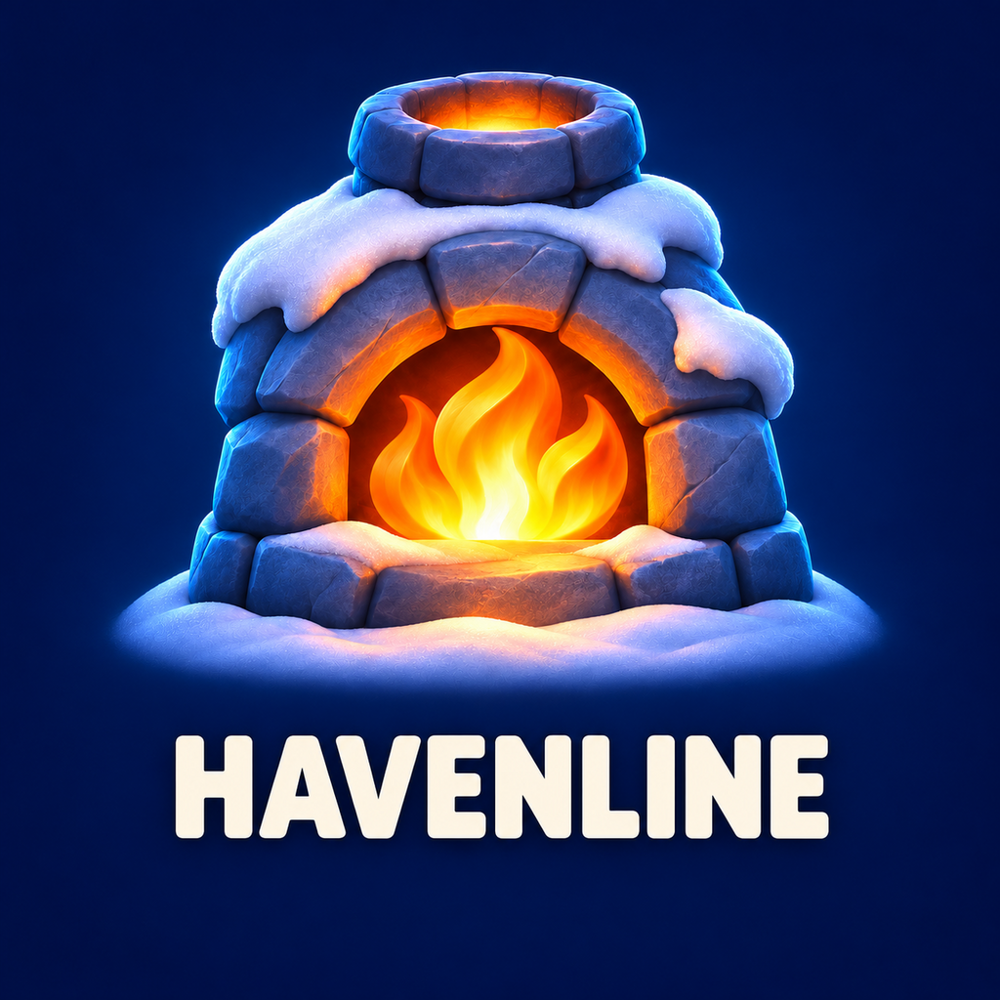
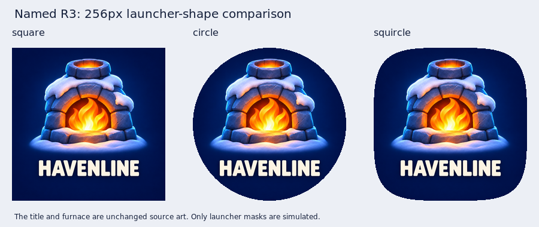
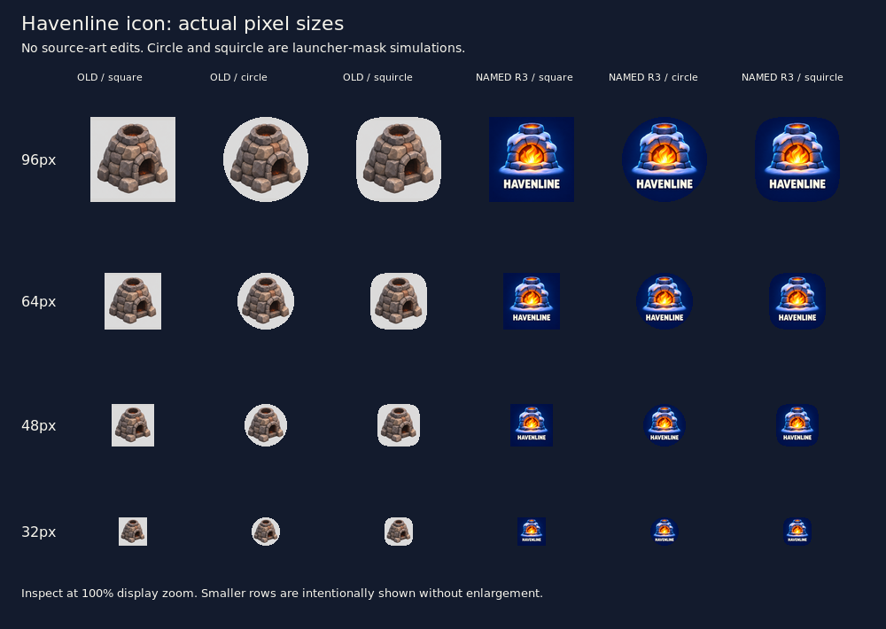

# HAVENLINE — hearth app icon

The new app icon keeps Havenline's warm hearth identity and adds the game's name, as requested. Blue sculpted stone, soft snow and a bright orange flame replace the muted gray product-render presentation. The exact word **HAVENLINE** appears in bold contemporary ivory capitals.

## Selected artwork

| Asset | Use |
|---|---|
| [1024px named icon](assets/havenline-icon-1024.png) | Square opaque master export and project icon |
| [512px named icon](assets/havenline-icon-512.png) | Smaller high-resolution distribution asset |
| [Android foreground](assets/havenline-adaptive-foreground-432.png) | Transparent hearth and name, padded for launcher masks |
| [Android background](assets/havenline-adaptive-background-432.png) | Explicit opaque midnight-blue layer |
| [Android monochrome](assets/havenline-monochrome-432.png) | Hearth and name mask for themed icons |

These files are generated raster artwork with documented mechanical export sizing. Prompt records and original sources are retained alongside the selected files. Generation used the built-in image tool; no creative pixel edits were made with code.

## Review and repairs

The first named layout (R2) clipped the outer parts of the first H and final E under a circular launcher mask. R3 moves the title inward and gives it more breathing room. The rejected source and its evidence are retained. The game name is readable at 64/96px; at 48px it is very small. At 32px the hearth remains recognizable, but full-name readability is not claimed.

[Requirements](ACCEPTANCE.md) · [Independent review](evidence/independent/FINAL_REVIEW.json) · [Integration instructions](integration/README.md) · [Artifact identities](ARTIFACT_MANIFEST.json)

## Integration boundary

The source audit observed the active game at Build 16 QA commit `429cb7ea56d98f7d023d7d6eeb18c89feb711fbc`. The current project already binds `res://assets/field/field_icon.png`. This isolated design branch contains the artwork and exact destination/export settings; it does not replace the concurrently maintained gameplay branch or rewrite historical QA presets. Apply the selected assets in that branch's next build after reconciling its current head.

The review is for this app-icon asset package and its simulated launcher masks. Physical-device installation, store publication and native gameplay/reference approvals remain outside this deliverable.
