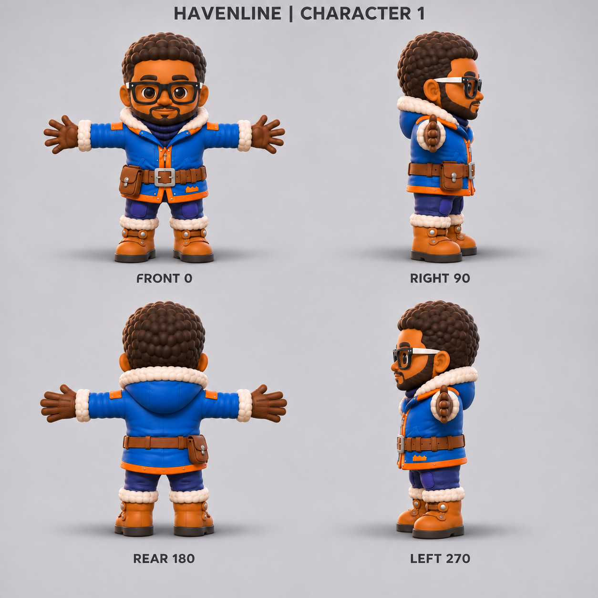
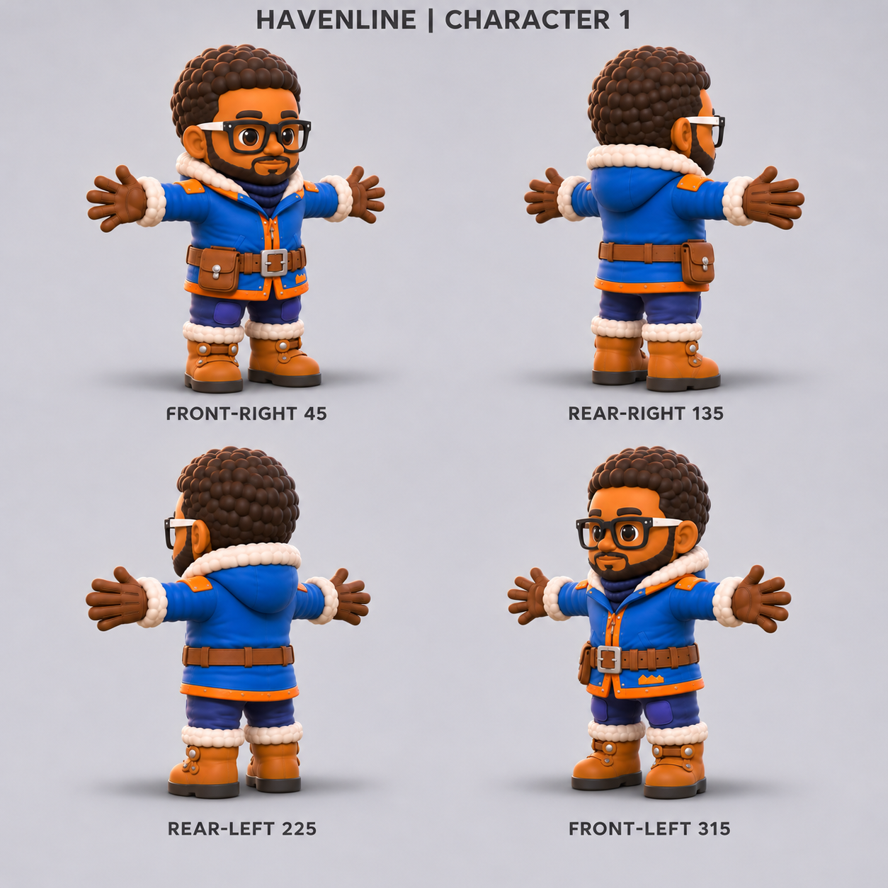
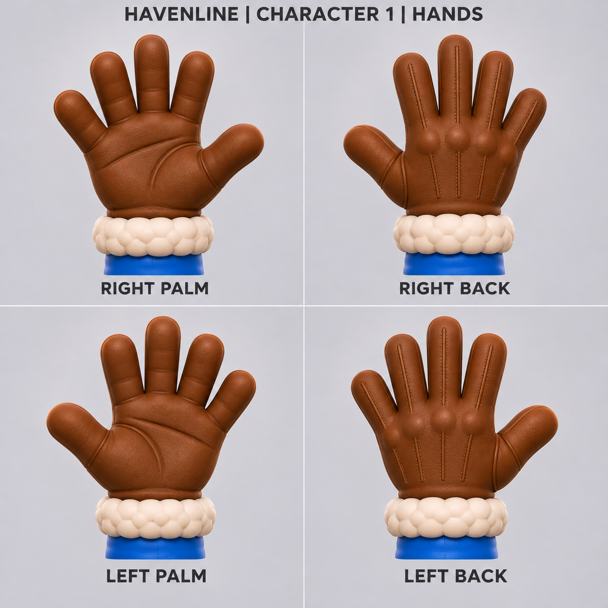
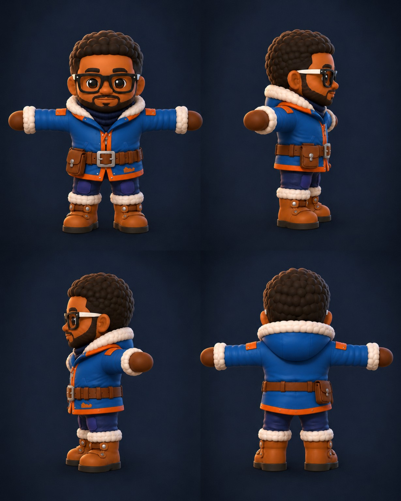

# Character 1 — turnaround gallery

Selected static sheets for the exact supplied design. Every displayed selected image is an unmodified alias of its generated original. All three sheets are native 1254 × 1254 PNGs.

## Cardinal views — 0°, 90°, 180°, 270°

Selected original: [cardinal r2](attempts/character-1-cardinal-r2.png). Independent visual score: 9.8/10. [Review](reviews/critic-cardinal-r2-verdict.json).

## Oblique views — 45°, 135°, 225°, 315°

Selected original: [oblique r1](attempts/character-1-oblique-r1.png). Independent visual score: 9.8/10. [Review](reviews/critic-oblique-r1-verdict.json).

## Hand details — both palms and both backs

Selected original: [hands r1](attempts/character-1-hands-r1.png). Independent visual score: 9.9/10. [Review](reviews/critic-hands-r1-verdict.json).

## Exact supplied design

Native source: 1229 × 1536 JPEG, supplied with the filename `18617.png`. The archived source bytes are unchanged. [Requirements and complete archive details](README.md).

## Preserved first attempt

The [original cardinal r1 sheet](attempts/character-1-cardinal-r1.png) remains available with its [failed review](reviews/critic-cardinal-r1-verdict.json), [exact prompt](prompts/character-1-cardinal-r1.txt), and [native crop evidence](reviews/critic-cardinal-r1-hand-crops.png).

Static reference acceptance does not establish a mesh, rig or animation.
