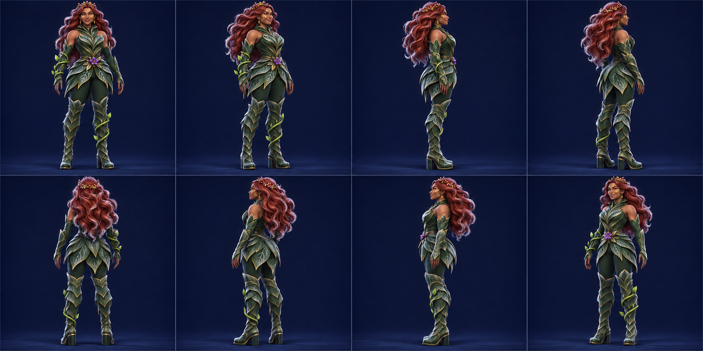

# Briar Vale

**Roster status:** Planned playable character. This is an original Havenline concept and design entry, not an unlock or an implemented rig.

An adult plant sorceress with flowing copper-red hair, emerald leaf armor, living vines and a winterberry crown. Keep the fuller-hip silhouette and moderate bust. Use restrained secondary motion on the body, hair and vines during runs and landings without losing gameplay readability.

## Ranged kit

Every cast auto-locks onto eligible enemies; no manual aiming or melee attack is needed.

| Move | In-game behavior |
| --- | --- |
| Poison Kiss | A blown glowing kiss homes in and applies damage over time. |
| Vine Lash | A vine snaps across the snow to strike the locked target; it can disrupt, push or sweep depending on the combo. |
| Root Rupture | Cracking snow telegraphs roots erupting beneath the target to damage and briefly pin nearby enemies. |

## Combo designs

| Combo | Sequence | Use |
| --- | --- | --- |
| Deadly Bloom | Poison Kiss → Vine Lash → Root Rupture | Focus damage on one target. |
| Briar Trap | Root Rupture → Vine Lash → Poison Kiss | Pin a group, sweep it, then tag the toughest enemy still standing. |
| Thorn Retreat | Vine Lash → Poison Kiss with a backstep → Root Rupture | Make space and stop pursuers. |

**Proposed mobile controls:** The first move selects the chain; one follow-up button advances the remaining beats. If a target falls, use a valid retarget or end the sequence without spending the unused move. Test readable windups, contact, recovery and sound at normal gameplay zoom. Exact ranges, cooldowns, damage and unlocks are open.

**Vehicle pairing:** Winterbriar, a planned two-wheel snow scout with twin cargo panniers. Mounted casting remains a design proposal.
