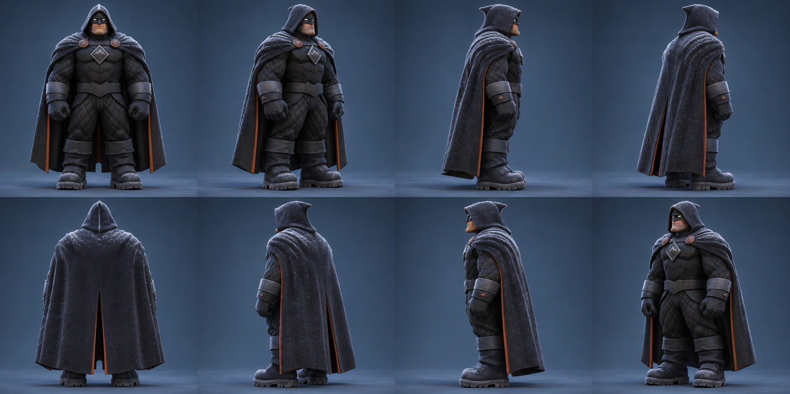

# Midnight Man

**Roster status:** Planned playable character. Concept art and gameplay design only; no model, rig, runtime roster slot, unlock or balance approval. Also called **Man** in the concept discussion. This addition does not replace any of the four existing leads.

## Play

- **Auto-targeted batarangs.** Midnight Man throws batarangs rather than orbiting tools. They automatically select eligible enemies, trees or mineable rocks and can damage, chop or mine those targets respectively. The precise throw trigger, target priority and cadence are not approved yet.
- **Close-range fighting.** Separate punch-and-kick sequences, with clear windup, contact and recovery at normal gameplay zoom. Current design sequences:

| Combo | Sequence | Purpose |
| --- | --- | --- |
| Sweep | Jab → cross → sweeping kick | Push back nearby enemies. |
| Breakthrough | Advancing punch → rising knee → heavy stomp | Stagger a durable single target. |
| Rebound (proposed finisher) | Side-step kick → spinning backfist → auto-targeted batarang | Create space and finish at range. Confirm whether this finisher stays hybrid or becomes all-melee. |

Keep his kit character-specific. It does not change the standard player orbiting axes or survivor two-handed tools. Damage, range, controls and unlock placement remain open. Next evidence: an actual rig and clips for all three combos and the throw, native footage at normal camera, correct target selection across combat and harvesting, and one harvest receipt per accepted event.
