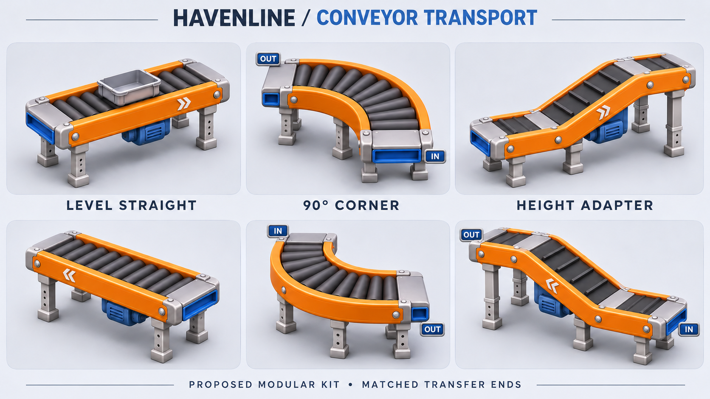
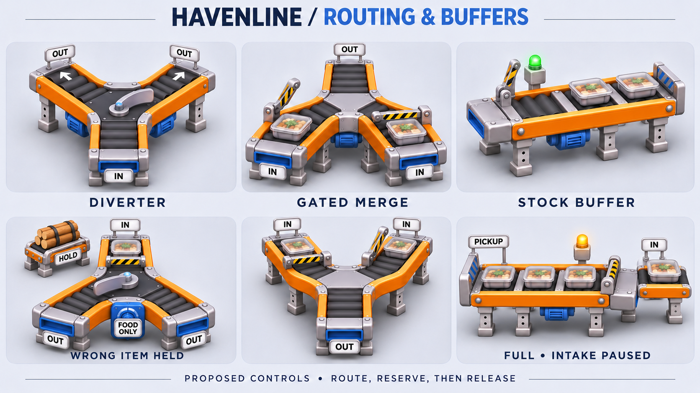
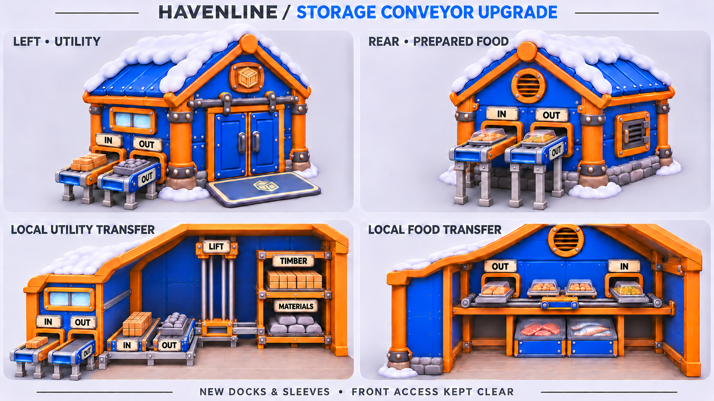
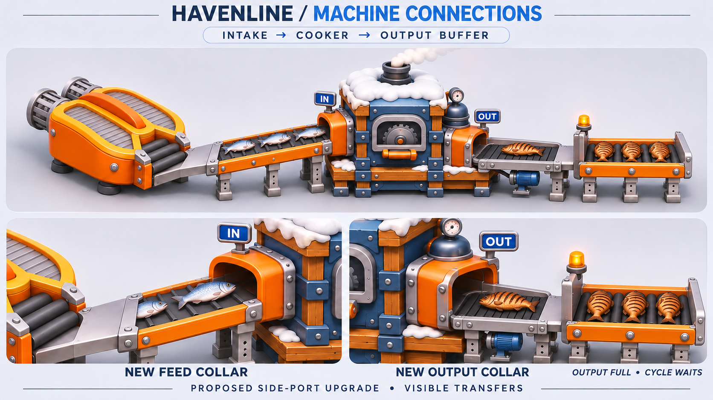
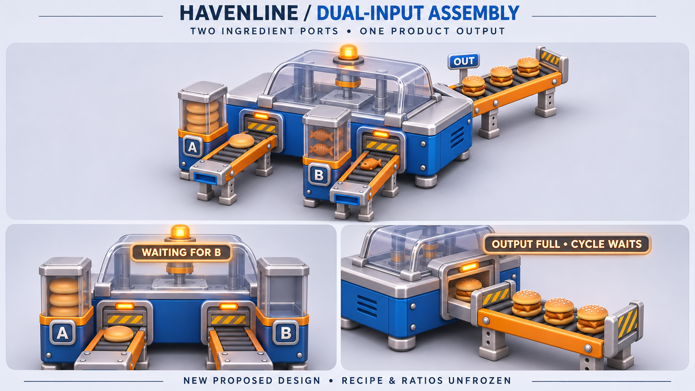
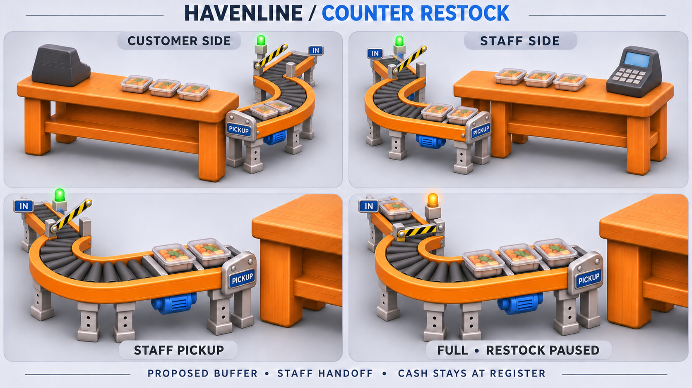
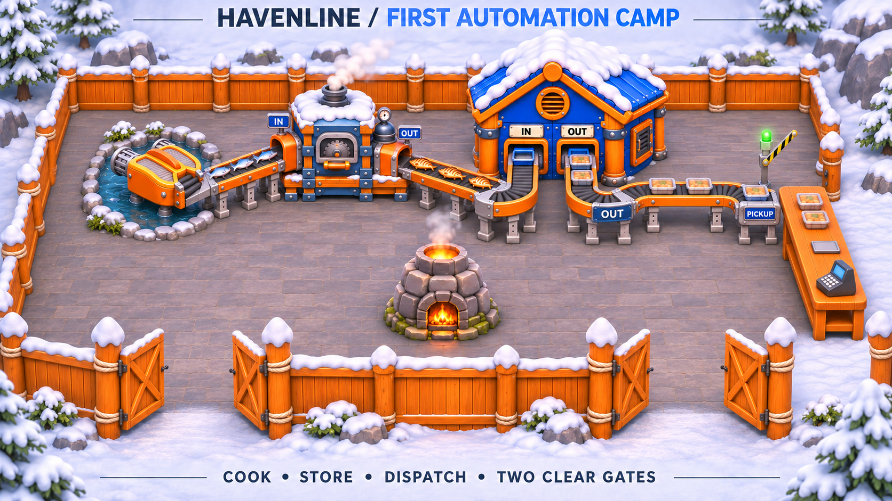
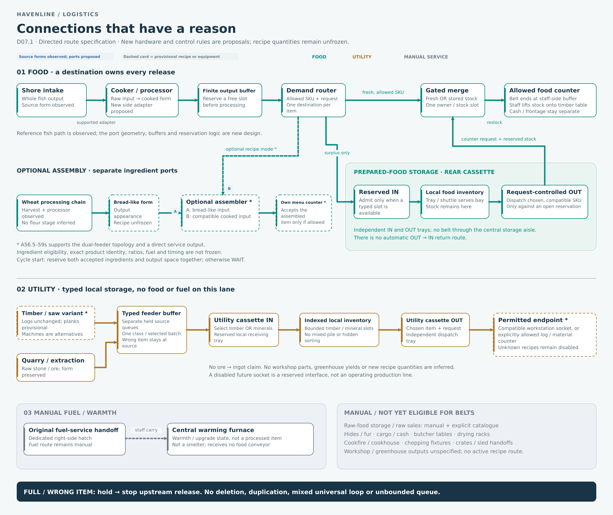
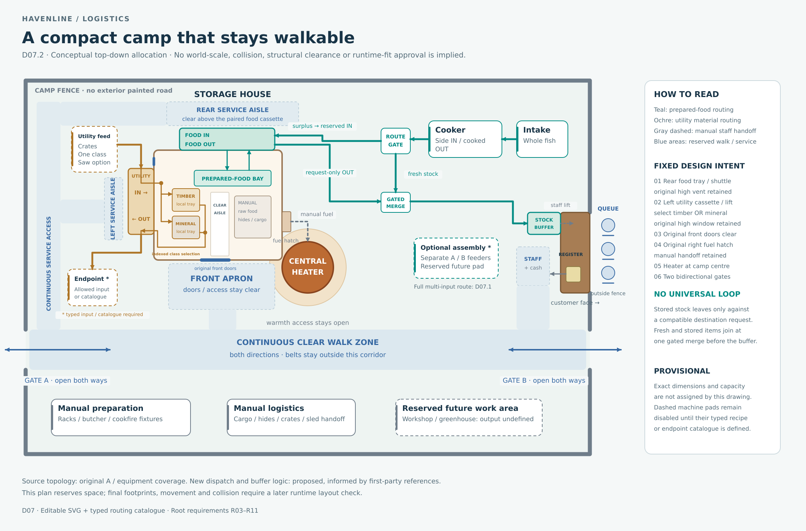

# Havenline conveyor reference gallery

Seven coordinated studies cover transport, routing, storage, production, assembly, sales and camp placement. The [README](README.md) explains the proposed behavior and evidence. The [exact route specification](design/D07-01-directed-routing.svg) and [camp allocation](design/D07-02-camp-allocation.svg) are editable; [routing-catalogue.json](design/routing-catalogue.json) names every station, port, item class and directed route.

These are static concept renders. Numerical recipes, capacities, costs, world dimensions, mesh collision and runtime behavior remain outside this approval.

## D01 — Transport modules

A level straight, real 90-degree roller corner and cleated incline form the basic connection kit. Opposing angles show supports, carrying surfaces and transfer interfaces.

## D02 — Routing controls and finite buffers

Filtering, destination selection and merge arbitration have different jobs. The full receiving buffer holds the next carrier upstream; incompatible stock is held separately. This generic full-buffer state, together with D07's reservation/backpressure rules, is the evidence for a full storage destination. D03 below demonstrates storage interfaces rather than a separate full-house state.

## D03 — Storage conveyor upgrade

The low left utility dock serves selected timber or mineral compartments through a local indexed lift. The rear prepared-food dock aligns with the prepared-food shelf and uses a horizontal tray/shuttle above the closed raw-food cabinets. IN and OUT are separate. Blue OUT sideguards carry clear OUT plates. Front doors/apron, the high left window, rear vent and right fuel hatch are retained.

## D04 — Intake → cooker → output buffer

The original intake's front roller discharge feeds a proposed side-input adapter. A powered output surface reaches a real finite buffer. The full state shows stock held upstream while the front service door and gauge remain accessible.

## D04B — Separate-input assembly

Ingredient A and ingredient B have separate magazines and accepted-input ports. Missing-input and output-full states make the wait understandable. This is a new Havenline proposal informed by the original A56.5–59s topology; exact ingredient identities and ratios are not approved.

## D05 — Staff-side customer restock

The supported curve ends at its own guarded pickup point with a gap before the timber table. Staff lift stock onto the counter. The original register faces staff; customer frontage and cash remain separate. The buffer's stop gate spans the straight approach before the bend.

## D06 — First automation camp

This is the explicitly labelled initial serial installation: intake → cooker → storage IN; requested storage OUT → guarded staff stock buffer → manual counter service. The rear food docks face the viewer; the original front doors face the far service aisle. A small enclosed water pocket leaves a continuous outer walking strip. The stone warming furnace stays central, with both bidirectional gate approaches open.

The [typed initial-deployment record](D06-initial-deployment.json) specifies this stage and its full/wrong-item/reservation rules. The D02/D07 upgrade below adds direct fresh supply, controlled surplus and the gated fresh/stored merge. That reviewed upgrade remains intact; its alternate placement is not claimed to be the exact footprint of this first-stage illustration.

## D07 — Exact directed routes

[Editable SVG](design/D07-01-directed-routing.svg) · [Machine-readable catalogue](design/routing-catalogue.json) · [Design notes and limits](design/D07-README.md)

The catalogue has 37 station dispositions, 25 directed routes and coverage of all 14 source equipment families. It distinguishes observed source topology from proposed ports, controls and provisional conversions.

## D07 — Camp allocation and access

[Editable SVG](design/D07-02-camp-allocation.svg)

This is a conceptual allocation, not a measured runtime-fit drawing. It keeps storage receiving/dispatch separate, connects side/rear service space to the clear gate corridor and ends automated restock at a staff buffer.

## Research and version history

- [Existing references: declared coverage and strongest time windows](research/existing/coverage.md)
- [New primary-source video register](research/new/new-source-register.json)
- [New research findings](research/new/research-findings.md)
- [Final selection and content acceptance](acceptance-status.json)
- [Exact generation history](generation-manifest.json)
- [All original attempts, including rejected repairs](attempts/)
- [Independent reviews](reviews/)

Selected aliases are exact copies of their approved native outputs. Rejected versions stay in the attempt history and are not silently substituted for the selected art. The failed seven-reference camp request produced no image and remains a failed invocation record. The final GitHub delivery receipt separately confirms remote publication and full-body verification.

