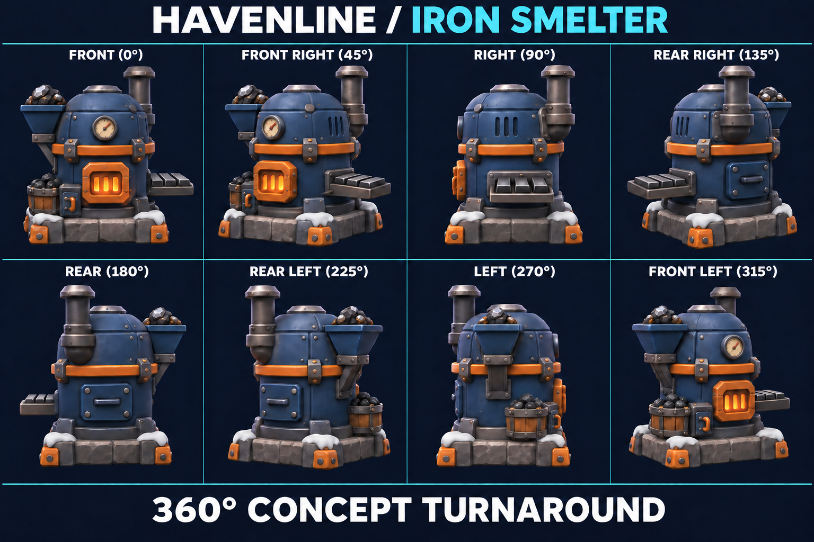
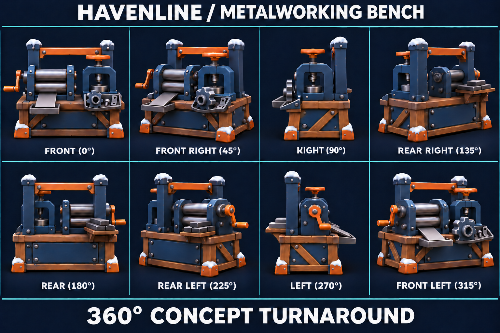
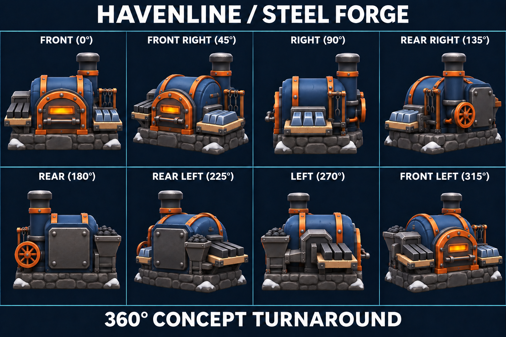
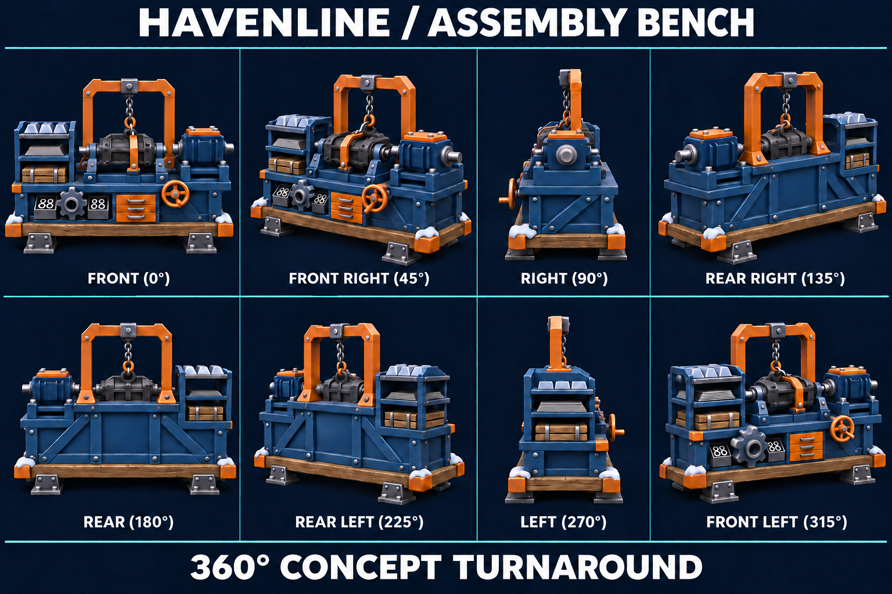
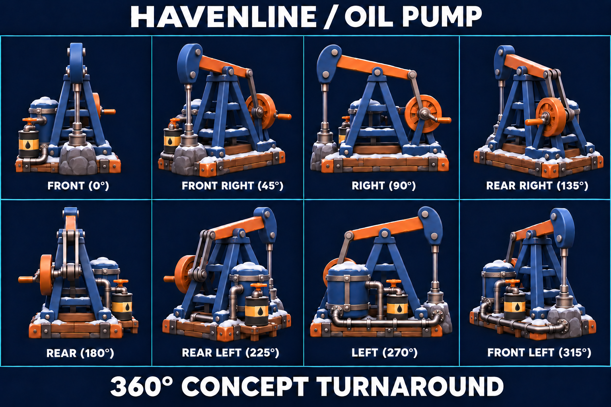
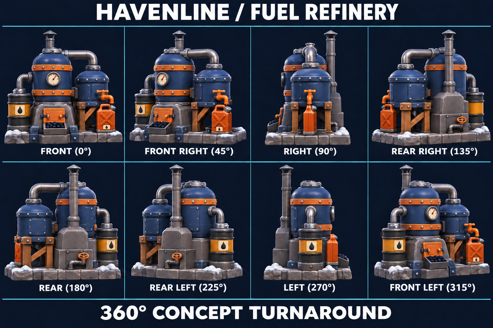

# Havenline — resource processing machines

**Six independently reviewed machine concept sheets · 48 illustrated views.**

These designs complete the current ordinary industrial resource chain. Each selected PNG is an unchanged copy of its passing generated candidate. The independent review covers the static artwork; native models, animation, economy balance and game integration remain future work.

[Resource completion gallery](../../ResourceTurnarounds/2026-11-27-completion/README.md) · [Recipes, dependencies and prior processors](PROCESSING_COVERAGE.md) · [Operating actions and service intent](SELECTED_DESIGN_NOTES.md) · [Exact selected files](MACHINE_SELECTED_MANIFEST.json) · [Independent final review](reviews/MACHINE_FINAL_REVIEW.md)

| Machine | Input | Output |
|---|---|---|
| Iron smelter | Iron ore + coal | Iron bars |
| Metalworking bench | Iron bars | Sheet metal or mechanical parts |
| Steel forge | Iron bars + coal | Steel |
| Assembly bench | Steel + parts + sheets; or steel + parts + planks | Drive assembly; or mobility assembly |
| Manual oil pump | Reachable outside-camp oil deposit | Crude oil |
| Fuel refinery | Crude oil + coal | Fuel |

The metalworking bench supports two recipes, and the assembly bench supports two recipes. They remain one building each. The outside-camp oil pump is manual; the declared material graph provides a path to the first fuel without already owning fuel or a vehicle. The existing sawmill, quarry, cooker, fish-line and wheat-processing art remains retained.

## Iron smelter

**Iron ore + coal → Iron bars**

## Metalworking bench

**Iron bars → Sheet metal or mechanical parts**

## Steel forge

**Iron bars + coal → Steel**

## Assembly bench

**Steel + parts + sheets; or steel + parts + planks → Drive assembly; or mobility assembly**

## Manual oil pump

**Reachable outside-camp oil deposit → Crude oil**

## Fuel refinery

**Crude oil + coal → Fuel**

## Download and export checks

The combined artbook contains 18 pages and all 15 selected sheets. The companion ZIP contains the original PNGs, a relative HTML gallery, the recipe graph and review records. [Export identity and reproduction](EXPORT_MANIFEST.json) · [Independent export review](reviews/EXPORT_FINAL_REVIEW.md). All 18 PDF pages passed actual visual inspection; all 15 PNGs and embedded PDF images preserve the selected originals.

## Custody and next implementation step

All original prompts, rejected attempts, repair iterations and actual critic evidence are preserved. The review selected revisions 3 / 5 / 3 / 4 / 5 / 2 in the gallery order. Exact file identity and review bindings are in the manifests.

Next implementation: create native machine assets against these references, demonstrate complete operating/pause/damage/recovery cycles, place typed manual/conveyor handoffs, and test the shared stock ledger and reachable first-use path. No workflow, active gameplay branch or task owner is changed by this art delivery.
