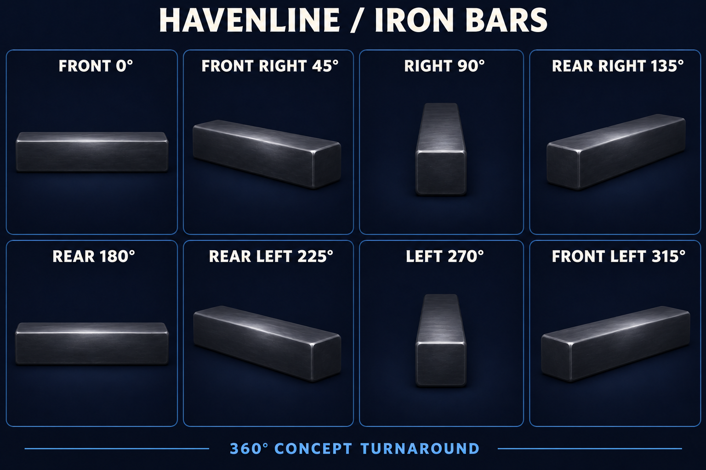
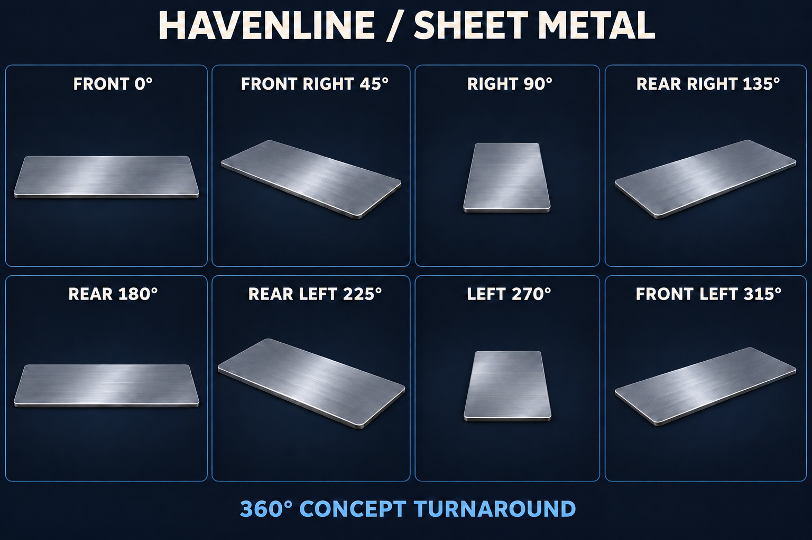
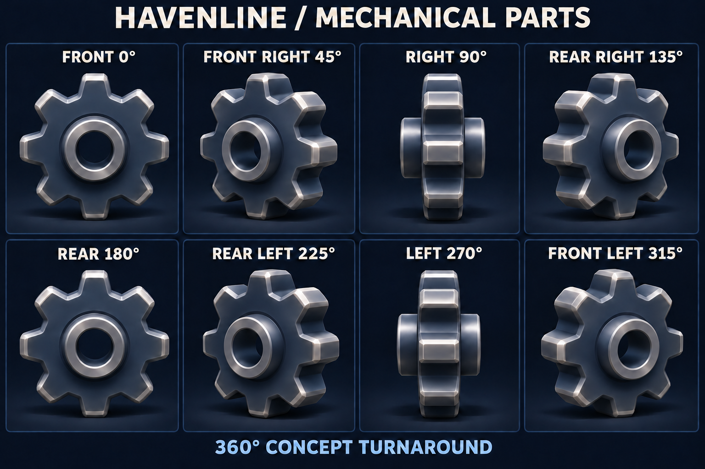
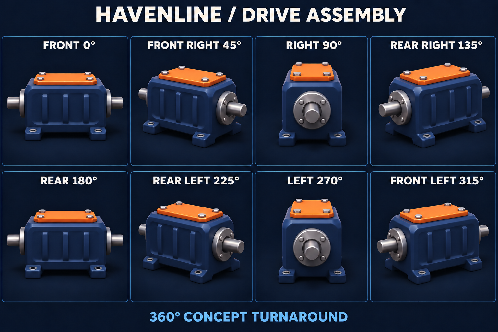
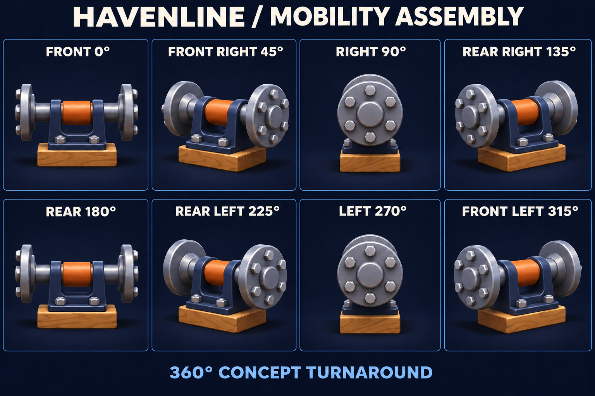
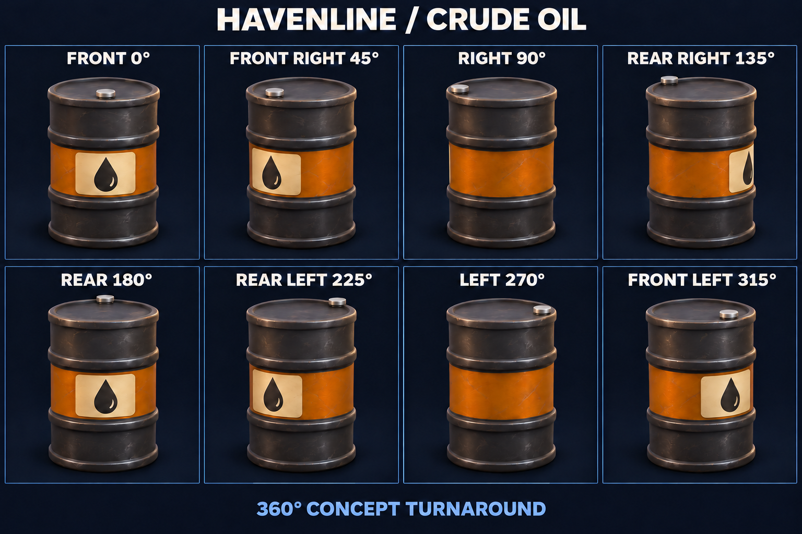
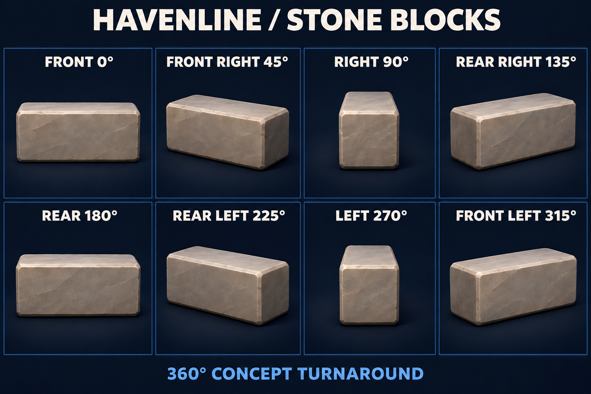
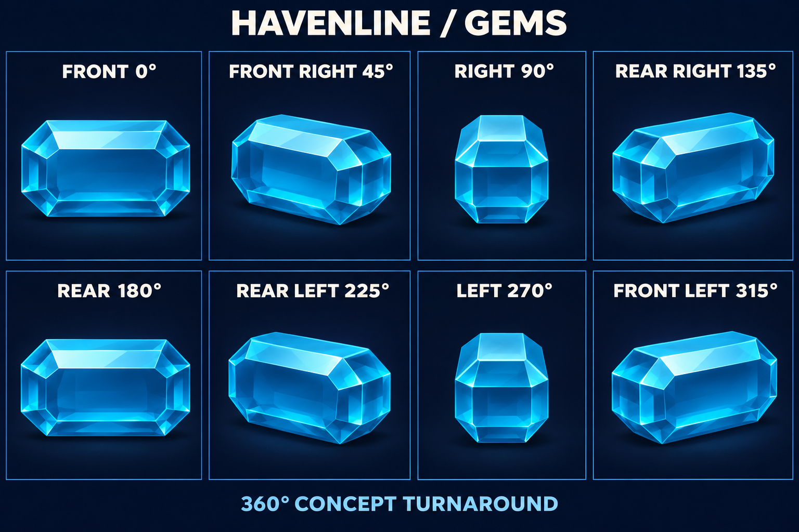
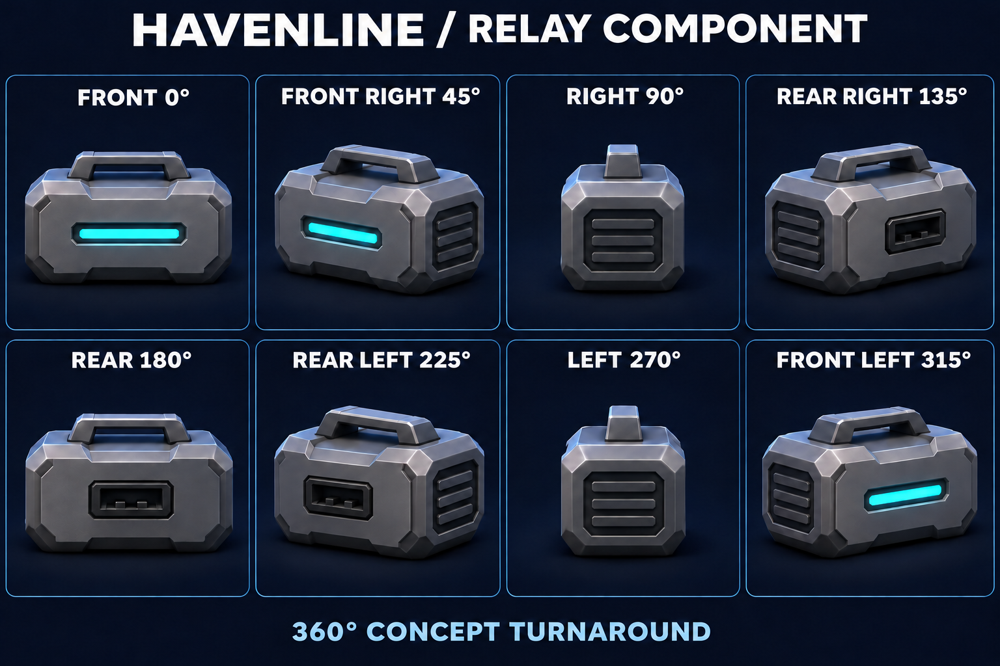

# Havenline resource completion

**Nine of nine remaining resource sheets are selected and independently reviewed.** Each sheet contains eight illustrated directions, for **72 views** in this completion set. Original image bytes and all rejected attempts are preserved.

[Exact selected manifest](RESOURCE_SELECTED_MANIFEST.json) · [Fresh independent review](reviews/RESOURCE_SELECTED_FRESH_REVIEW.md) · [Resource and machine map](RESOURCE_MACHINE_MAP.md) · [Coverage audit](audit/RESOURCE_INVENTORY_AUDIT.md)

## Coverage and status

The preserved **33 earlier sheets plus these nine make 42 resource sheets / 336 illustrated views**. They cover **27 current identity families**: 23 materials/components, two currencies, cargo presentation and the finite relay object. Fifteen prior sheets are variants or reserve concepts, so 42 sheets does not mean 42 inventory balances.

The fresh critic inspected all nine full sheets, all 72 illustrated views and 18 closeups. Every required scoped dimension scored 10.0 with no open mandatory defect. These scores approve the stated raster concept scope only. The printed angles describe an illustrated orbit; they do not prove calibrated cameras or shared native 3D geometry. Models, animation, recipes, balance and runtime integration remain outside this art approval.

**Publication status:** published and verified with the six processing-machine sheets. [Exact remote delivery evidence](../../ProcessingMachines/2026-11-27/PUBLICATION_READBACK.json). The byte manifest and raw reviews are frozen stage records; their earlier publication-pending fields are superseded by this receipt and the current checkpoint.

## Full resource sheets

### 01 · Iron bars

Ore and coal are processed at the smelter. Bars feed the metal bench and steel forge, and support machine frames.

[Open full sheet](../2026-11-27-industrial/selected/iron-bars.png) · Resource ID: `iron_bars`

### 02 · Sheet metal

Pressed at the metalworking bench for vehicle panels, garage doors, refinery casing and drive assemblies.

[Open full sheet](../2026-11-27-industrial/selected/sheet-metal.png) · Resource ID: `sheet_metal`

### 03 · Mechanical parts

The gear represents aggregate parts stock used by assemblies, pumps, the refinery and mechanical upgrades. It does not add a separate gear wallet.

[Open full sheet](../2026-11-27-industrial/selected/mechanical-parts.png) · Resource ID: `mechanical_parts`

### 04 · Drive assembly

Assembled from steel, mechanical parts and sheet metal for useful powered vehicles and lifting/hauling equipment.

[Open full sheet](../2026-11-27-industrial/selected/drive-assembly.png) · Resource ID: `drive_assembly`

### 05 · Mobility assembly

Assembled from steel, mechanical parts and planks for world-appropriate wheel, track, rail or marine fittings. The saved resource key remains traction_kit.

[Open full sheet](../2026-11-27-industrial/selected/mobility-assembly.png) · Resource ID: `traction_kit`

### 06 · Crude oil

Extracted at a reachable outside-camp manual oil pump, then carried to the refinery. The drum represents the liquid resource; it is not separate container stock.

[Open full sheet](../2026-11-27-industrial/selected/crude-oil.png) · Resource ID: `crude_oil`

### 07 · Stone blocks

Stone is processed at the existing quarry/drill station for garage foundations, machine bases, route structures and defenses.

[Open full sheet](../2026-11-27-industrial/selected/stone-blocks.png) · Resource ID: `blocks`

### 08 · Gems

The selected premium currency. This sheet adds no mine, manufacturing machine, price, exchange rate or paid progression requirement.

[Open full sheet](../2026-11-27-industrial/selected/gems.png) · Resource ID: `premium_gems`

### 09 · Relay component

A finite serialized World 10 project module carried by the Relay Rover and installed in the restored network. Its recovery and replacement worksite is separate authored later-world scope.

[Open full sheet](../2026-11-27-industrial/selected/relay-component.png) · Resource ID: `relay_component`

## Processing-machine handoff

The six dedicated new industrial sheets belong to the smelter, metalworking bench, steel forge, assembly bench, manual oil pump and coal refinery. The resource IDs and input/output families are frozen in the [machine map](RESOURCE_MACHINE_MAP.md). Existing saw, quarry, cooker, fish and wheat references remain preserved. The finite relay recovery/fabrication worksite remains a separate World 10 boundary.

## Preserved evidence

The copied inventory audit is the unchanged initial inspection snapshot. Its stale-checkpoint and missing-review findings are resolved by this completion package; the current selected manifest, custody validation and checkpoint describe the reconciled local state.

- [Original incomplete README and checkpoint](../2026-11-27-industrial/history/prior-incomplete-checkpoint/PRESERVATION.json) retain the exact earlier wording.
- [Original rejected and repaired attempts](../2026-11-27-industrial/attempts/) remain available unchanged.
- [Original independent reviews](../2026-11-27-industrial/reviews/) include the restored final R3 pass.
- [Fresh evidence custody](EVIDENCE_CUSTODY.json) maps the raw review’s source paths to unchanged repository copies.
- [Current checkpoint](../2026-11-27-industrial/CHECKPOINT.json) records the completed static-art and verified publication milestones.
