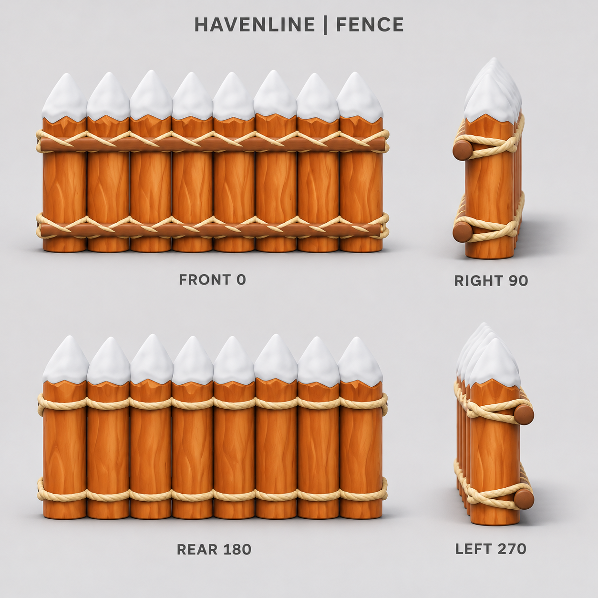
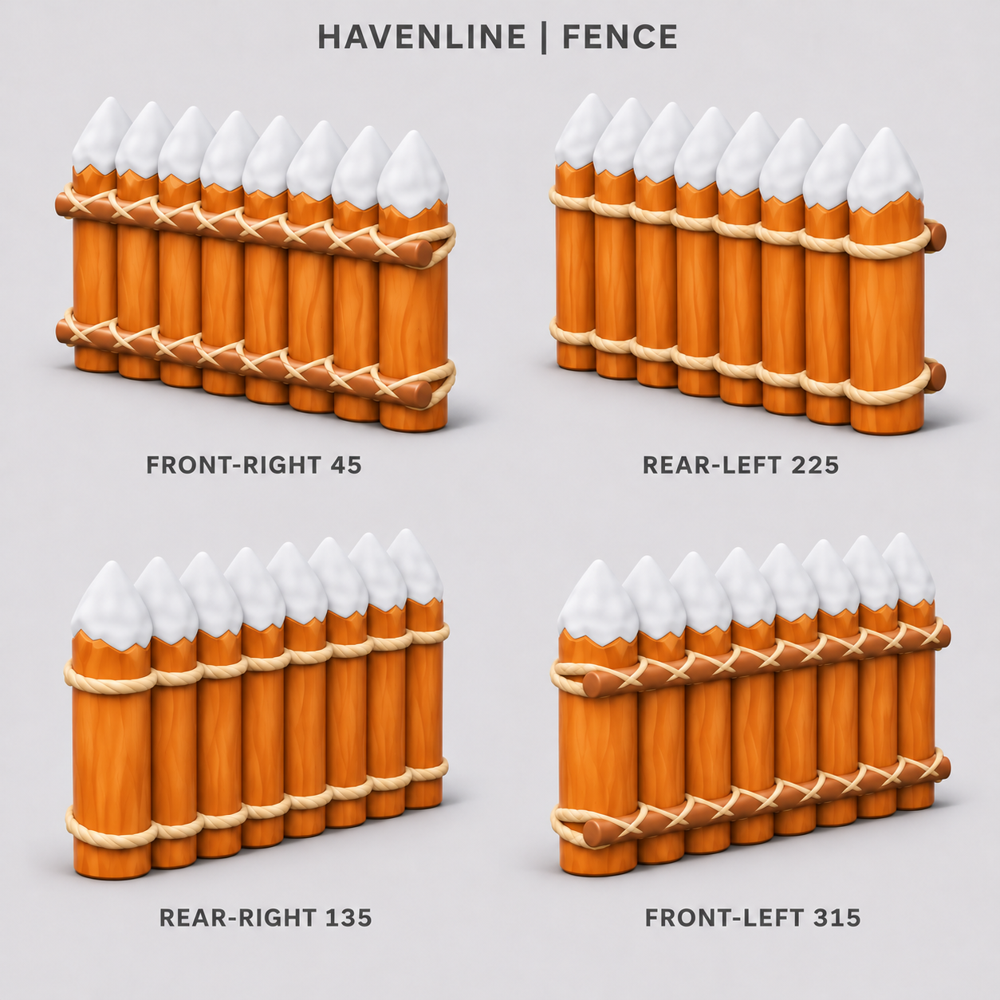
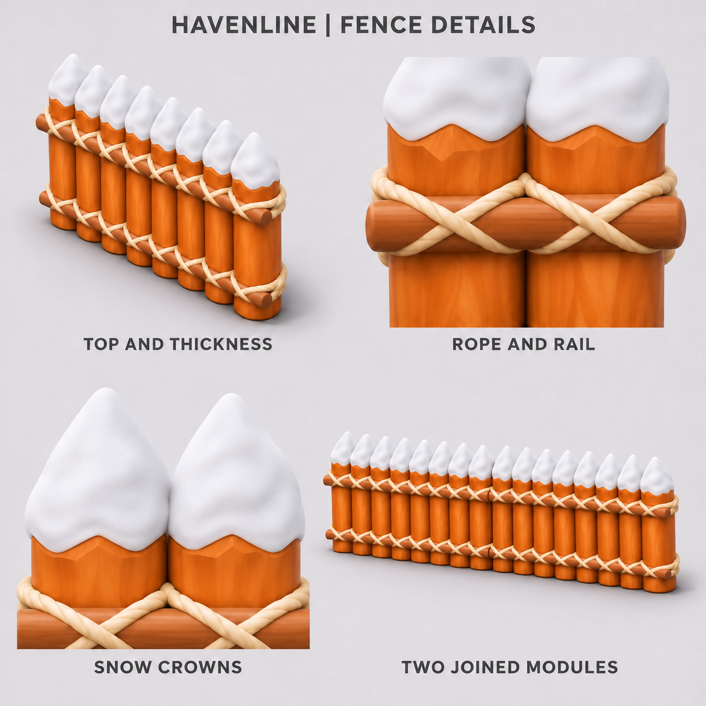
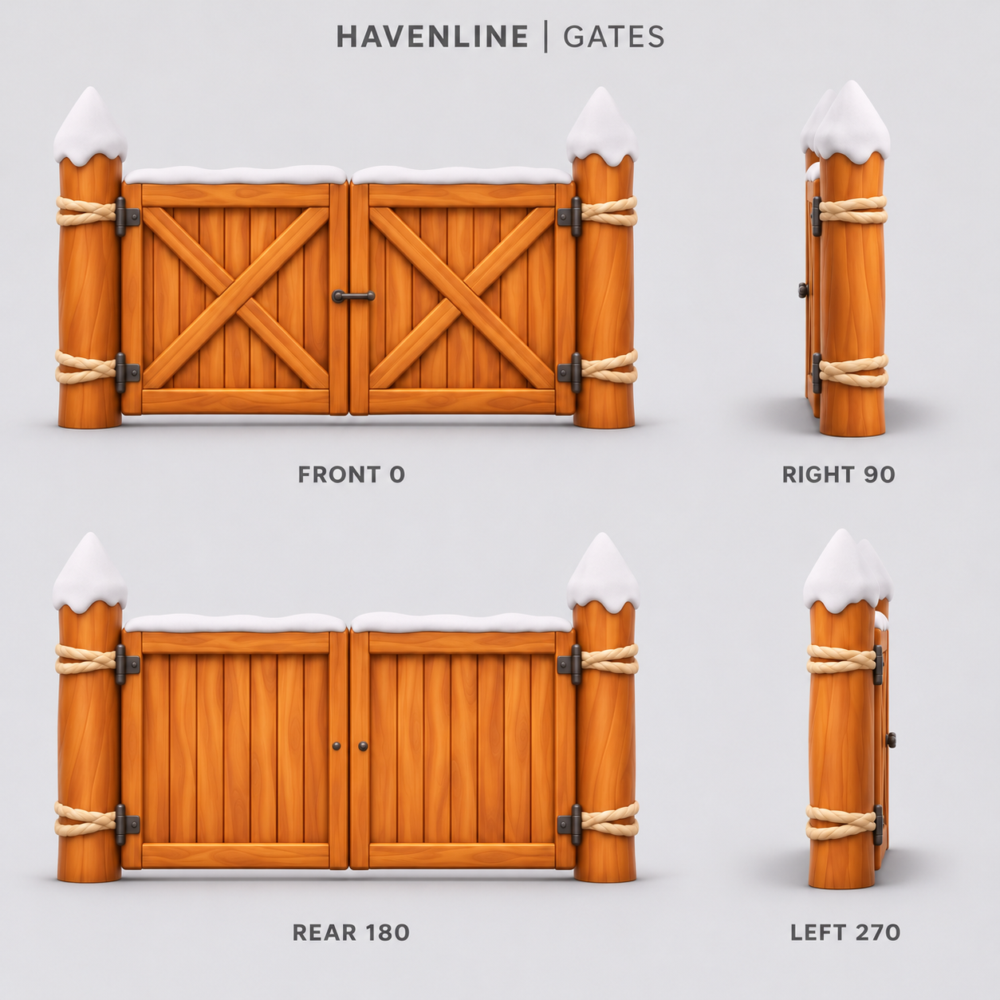
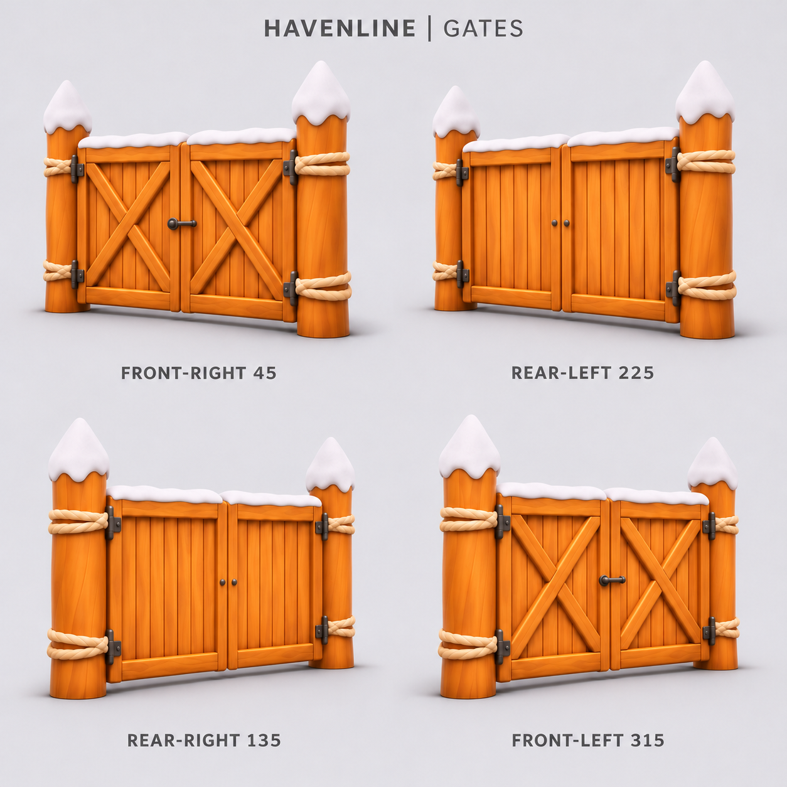
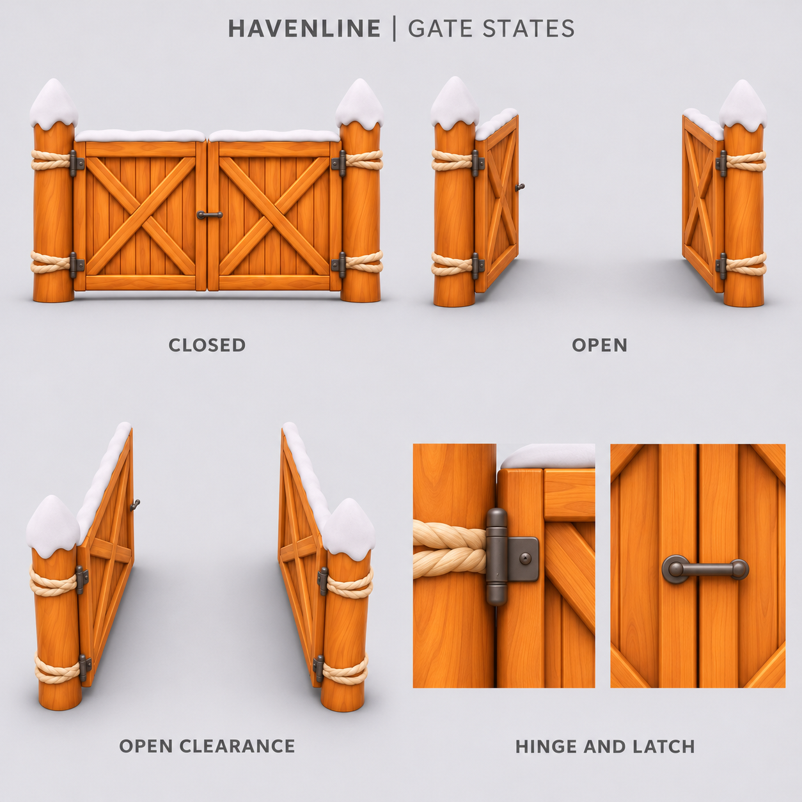
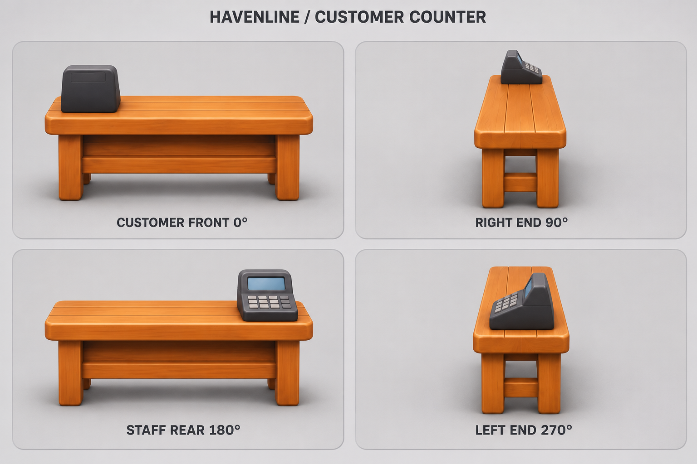
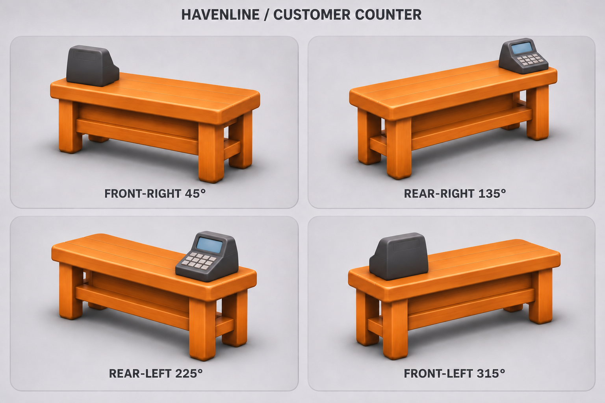
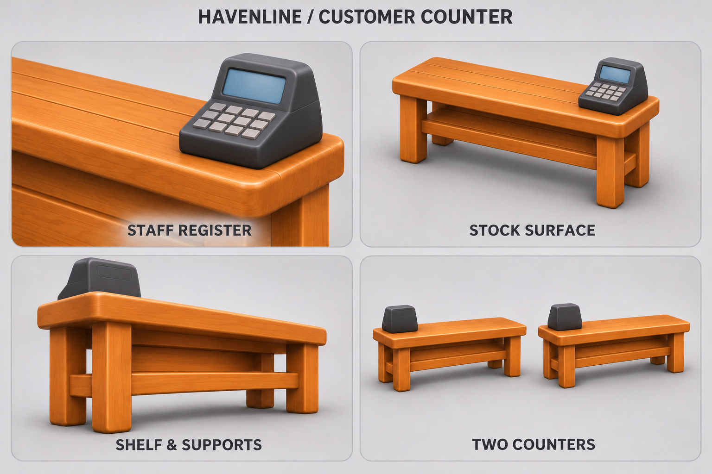

# Havenline structure reference gallery

Nine selected static studio sheets. Click a preview to open its original image.

| Structure | Cardinal views | Oblique views | Details / states |
| --- | --- | --- | --- |
| Fence |  |  |  |
| Gates |  |  |  |
| Customer counter |  |  |  |

These are actual returned native images, preserved without upscaling. The [image index](image-index.json) records each original's dimensions and hashes. See [scope and source decisions](README.md) and [exact selection/review bindings](selected-status.json).
