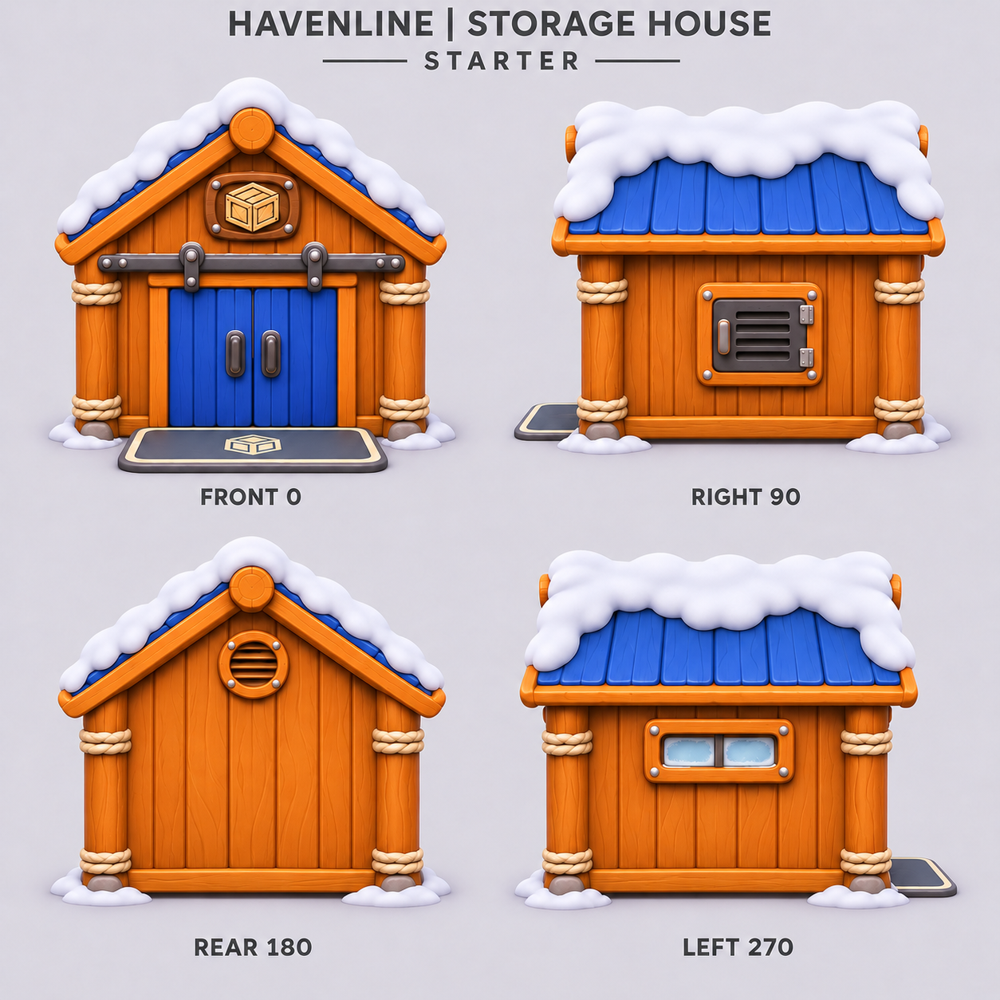
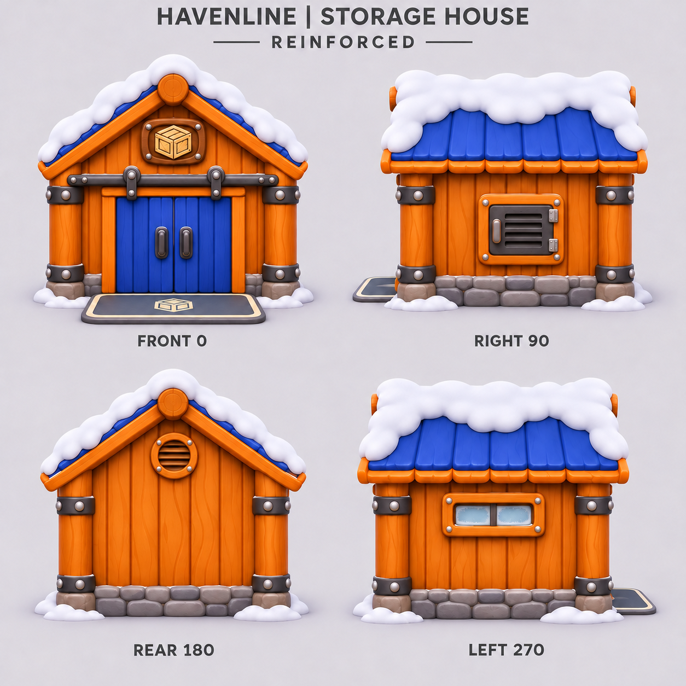
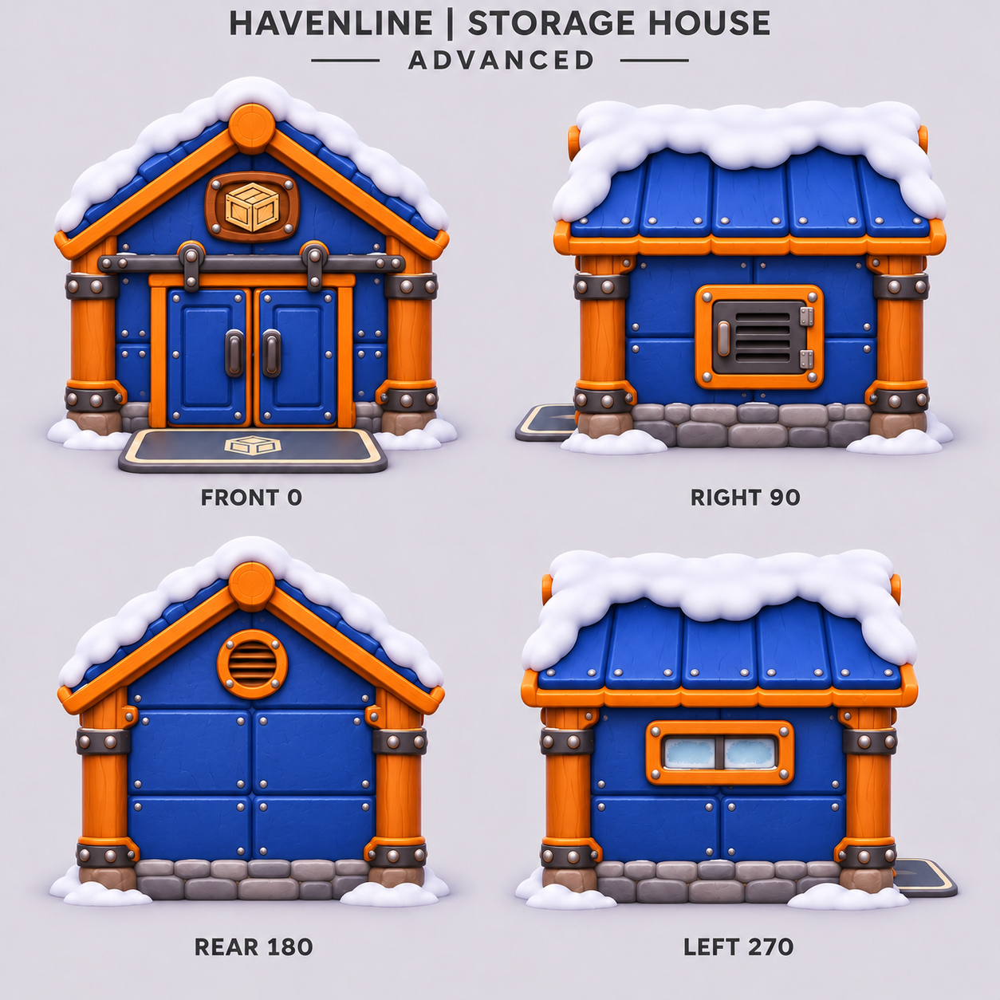
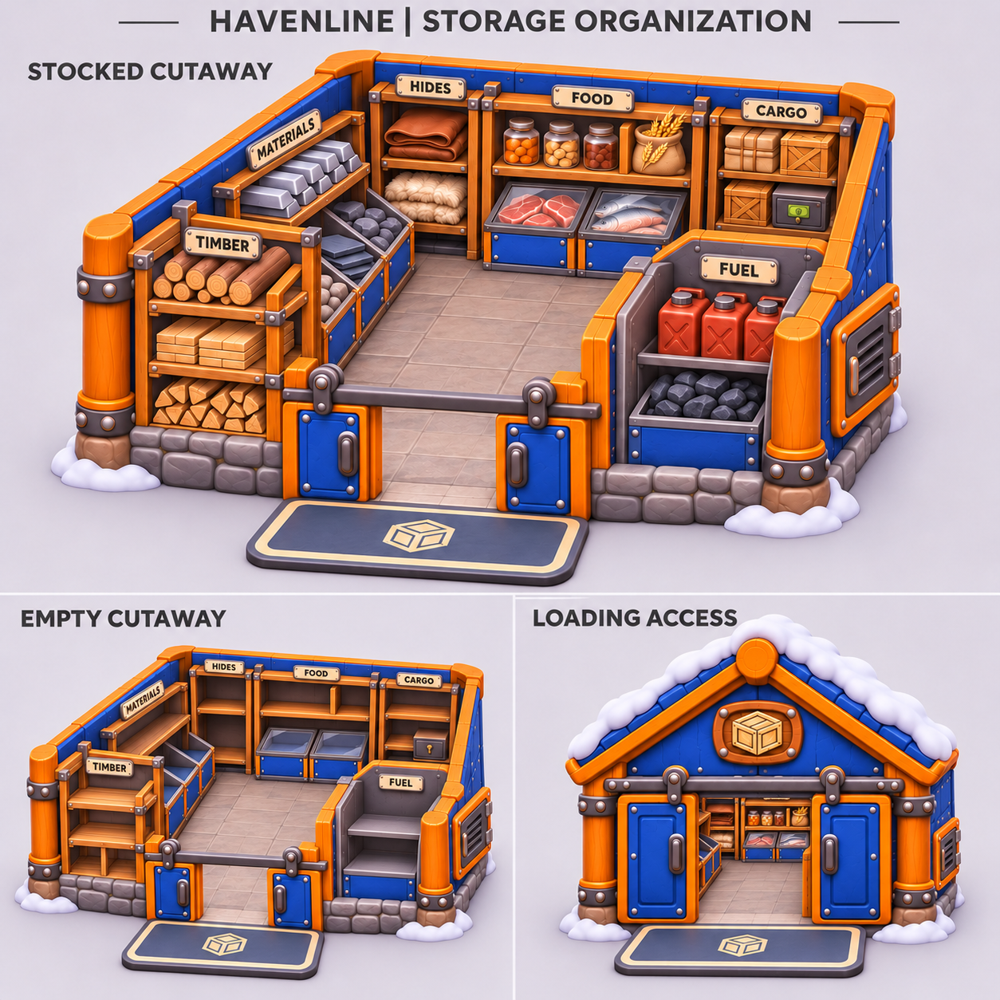

# Upgradeable storage-house gallery

Four selected static reference sheets for the proposed Havenline camp storage house. Each image is an unmodified alias of its generated original.

## Timber Storehouse

Native 1254 × 1254 PNG. Independent visual score 9.9/10. [Original](attempts/storage-house-starter-r1.png) · [Review](reviews/critic-starter-r1-verdict.json).

## Reinforced Storehouse

Native 1254 × 1254 PNG. Independent visual score 9.9/10. [Original](attempts/storage-house-reinforced-r2.png) · [Review](reviews/critic-reinforced-r2-verdict.json).

## Insulated Supply Depot

Native 1254 × 1254 PNG. Independent visual score 9.9/10. [Original](attempts/storage-house-advanced-r1.png) · [Review](reviews/critic-advanced-r1-verdict.json).

## Storage organization and use states

Native 1254 × 1254 PNG. Independent visual score 9.9/10. [Original](attempts/storage-house-organization-r2.png) · [Review](reviews/critic-organization-r2-verdict.json).

[Resource coverage, source bindings and archive details](README.md). All generated revisions and their exact review records remain available; open [attempts](attempts/) for the originals.

Static visual references do not establish native model or runtime approval.
