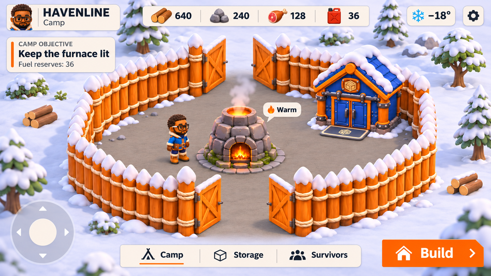
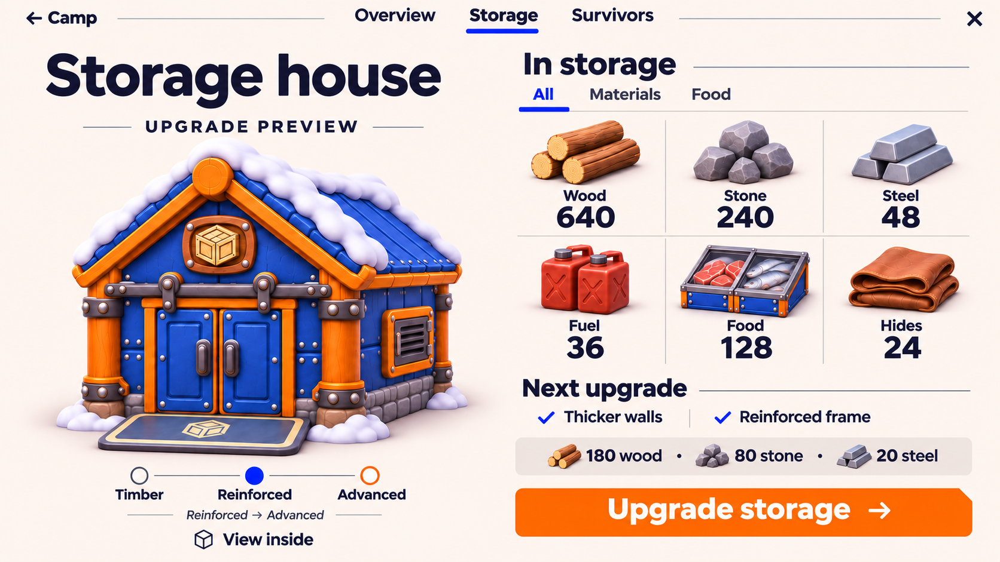
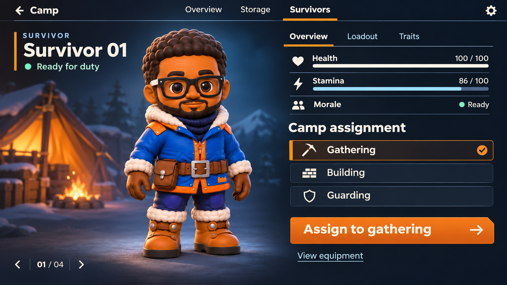

# Havenline UI concept gallery

Three distinct complementary landscape screens using the approved winter art language. Every selected image below is an exact, native-resolution copy of its generated original.

## Camp HUD — world-led layout

Compact resource rail, a small objective, one movement joystick and a contextual Build action around an open camp illustration.

Native 1672 × 941 PNG. Independent visual review: 9.5/10. [Original](attempts/ui-camp-hud-r2.png) · [Review](reviews/critic-ui-camp-hud-r2-verdict.json).

## Storage — bright inventory and upgrade view

A prominent approved house preview, readable resource quantities, a current-to-next upgrade distinction and one primary upgrade action.

Native 1672 × 941 PNG. Independent visual review: 9.6/10. [Original](attempts/ui-storage-r2.png) · [Review](reviews/critic-ui-storage-r2-verdict.json).

## Survivor — midnight profile and assignment view

The approved Character 1 design in an idle pose, a restrained status display and a clear camp-assignment choice.

Native 1672 × 941 PNG. Independent visual review: 9.7/10. [Original](attempts/ui-survivor-r1.png) · [Review](reviews/critic-ui-survivor-r1-verdict.json).

[Design rationale, exact source bindings and archive details](README.md).

Static UI concepts with illustrative values; no implemented gameplay or interaction approval is implied.
