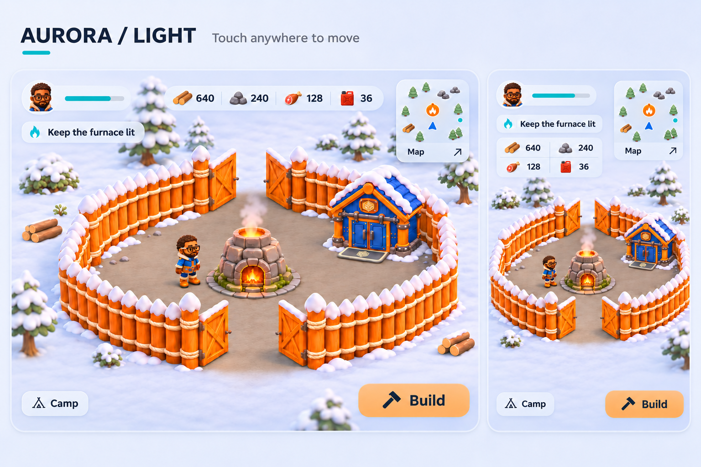
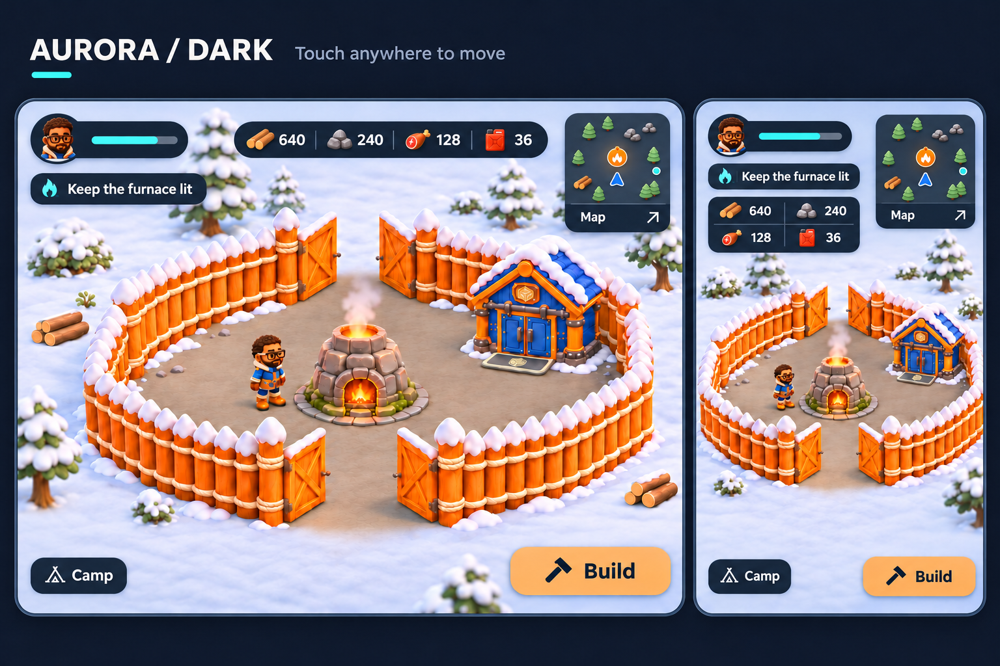

# Aurora — Light and Dark

Aurora is the confirmed visual family. These exact refinements are new artwork for owner review, with no visible joystick in either theme or orientation. The gameplay scene stays in daylight.

## Aurora Light

Quiet light panels, dark type and a restrained warm primary action.

## Aurora Dark

Matching matte dark UI surfaces with readable light type over the same daylight camp.

The boards are static visual proposals. Touch-anywhere input and native rotation/fold/safe-area behavior are not implemented or tested by these images. See [decision/input notes](DECISIONS_AND_INPUT.md).
