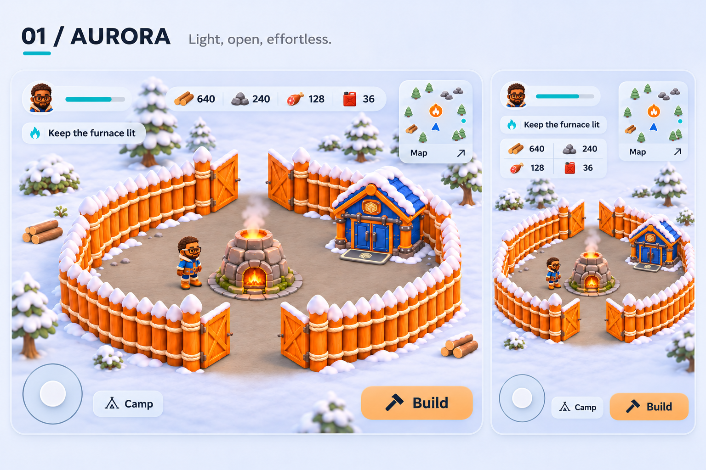
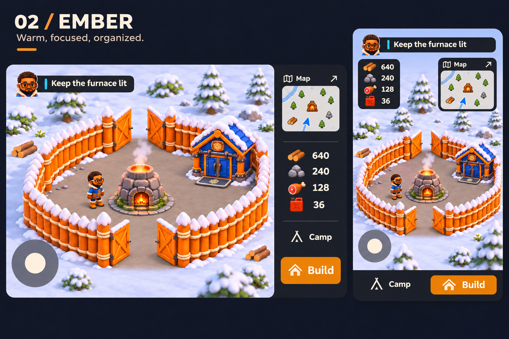
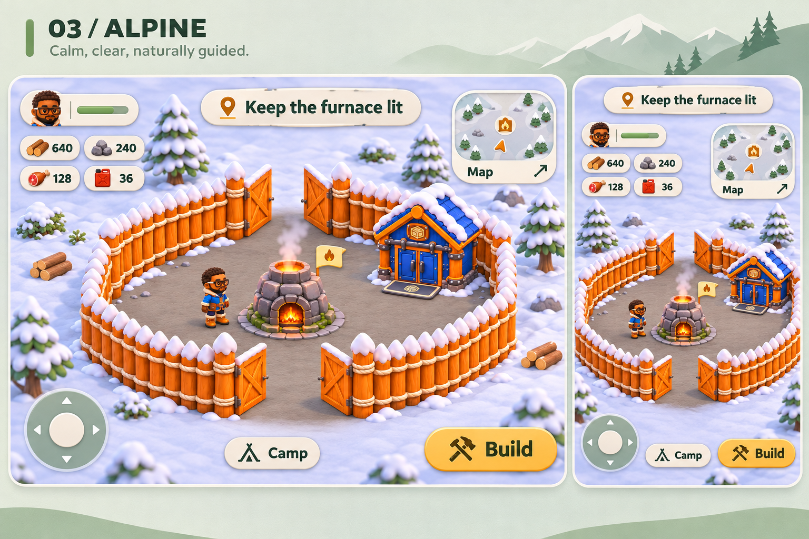

# Three modern HAVENLINE UI candidates

Current comparison set; owner selection is still open. Each image is a static concept board, with illustrative portrait/landscape layouts and a minimap-expansion affordance.

## 01 — Aurora

Light, open and restrained. Sparse floating controls keep the camp visible.

## 02 — Ember

Focused dark command layout. A landscape side rail becomes a shallow portrait dock.

## 03 — Alpine

Soft porcelain and sage, grouped status and simple guidance.

All originals and earlier revisions remain in the [generated-image directory](generated/). See the [README](README.md) for review scope and implementation limits.
