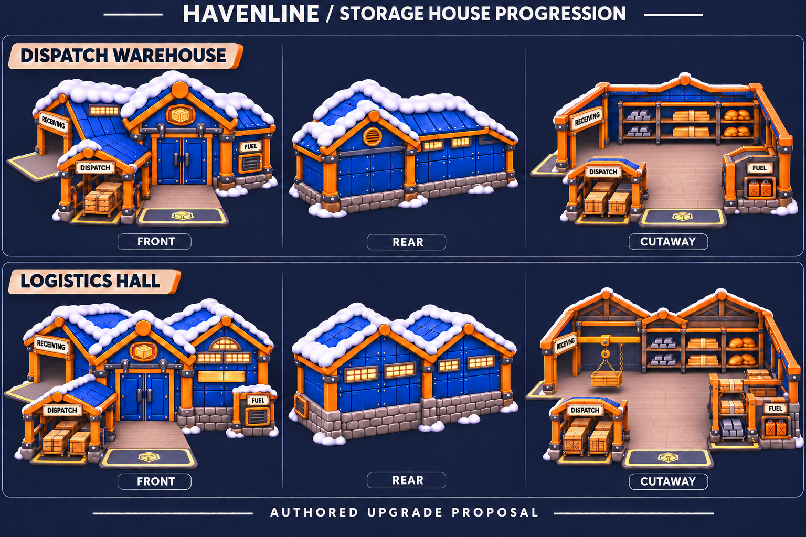
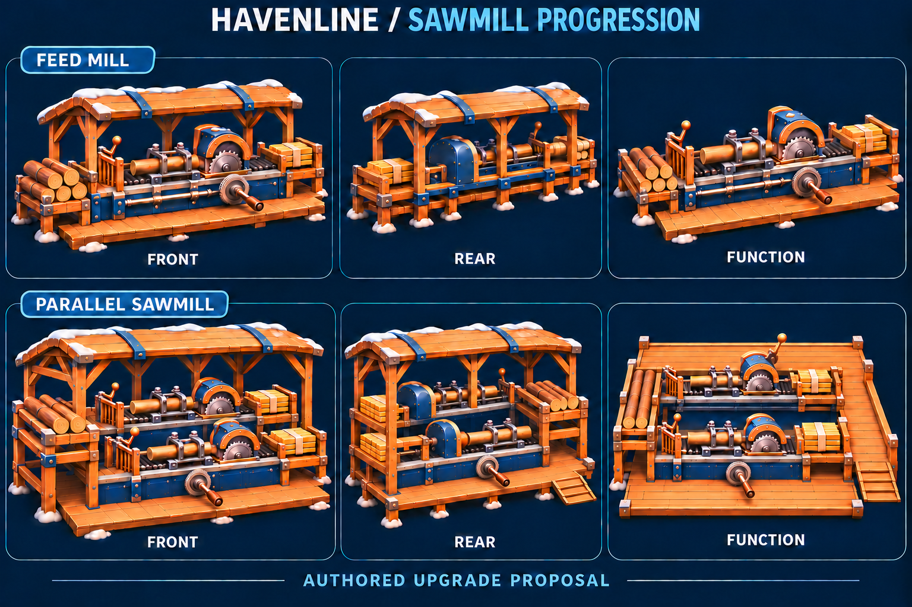
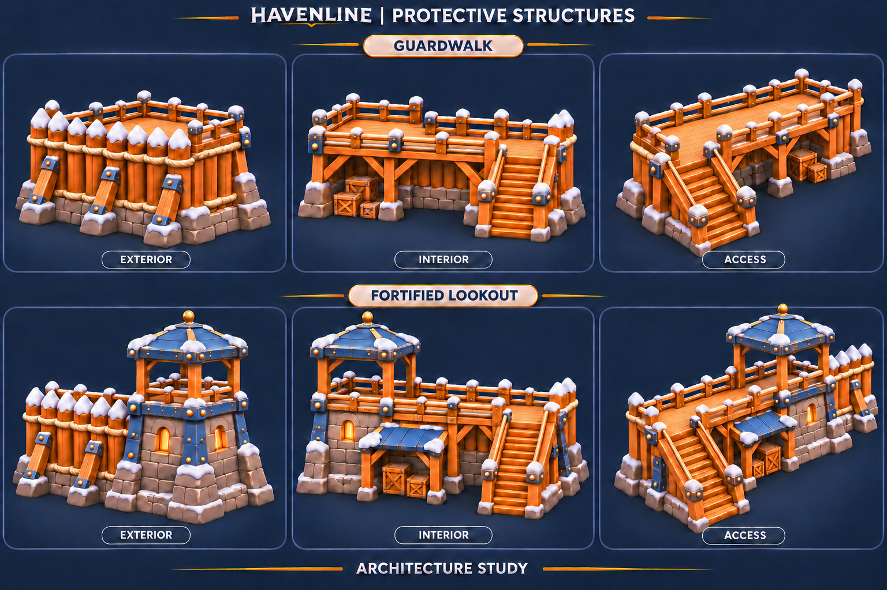
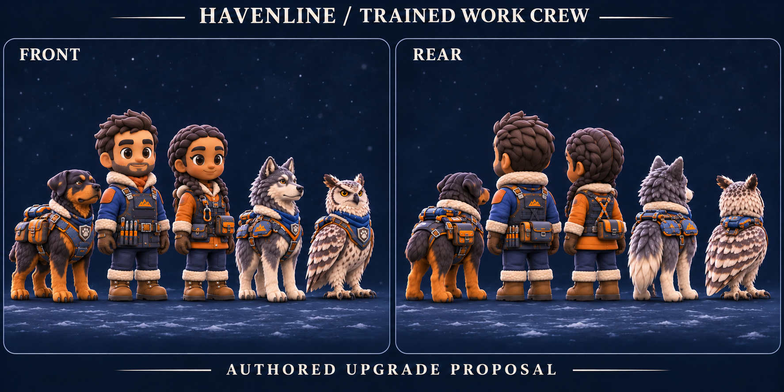
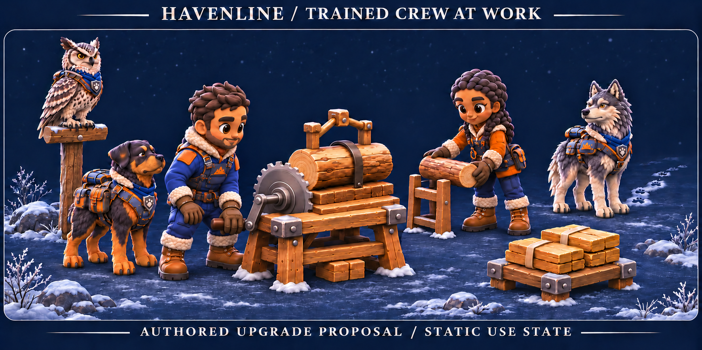
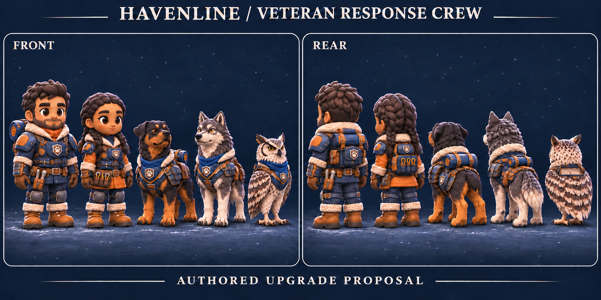
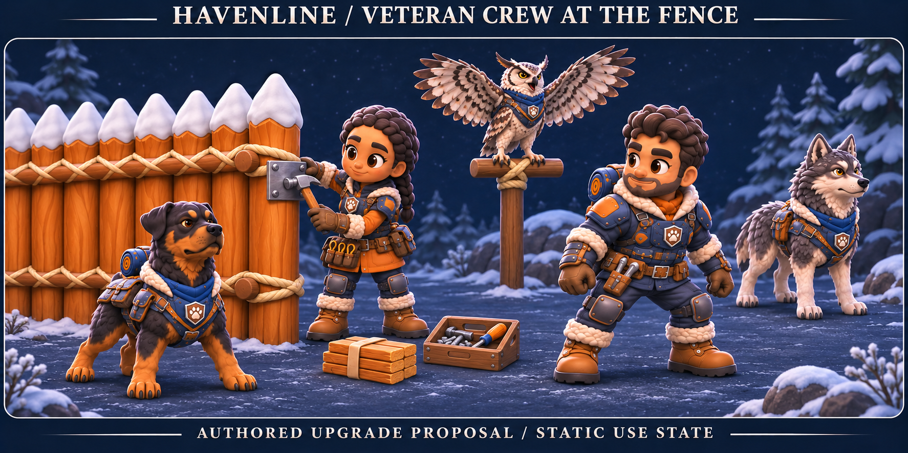

# World 1 upgrade review gallery

This gallery preserves generated candidates, exact invocation/error records and independent review evidence. **Every image remains unselected by the owner. No whole-task, native gameplay, animation, audio, balance or device approval is claimed.** A scoped document or architecture review is not a full defense or game approval.

Current direction: substantial changes worth purchasing, with useful production/work/defense behavior; 10 worlds with 50 levels each. The [active design entry point](README.md) and [purchase-value plan](PURCHASE_VALUE_UPGRADE_PLAN.md) explain the proposed scope and remaining gates.

## Current best drafts designated by root

### w1val-04-r5

**Current explicit status:** PASS_SCOPED_STATIC_PROPOSAL_NOT_OWNER_SELECTED

**Scope:** AUTHORED_STATIC_CONCEPT_ONLY

Storage: receiving and dispatch separation, reserved staging, clear central aisle and a left manual loading hoist. The two proposed stages retain the selected storage-house identity. Independent scoped score: 9.9/10.

Root's display designation does not constitute owner selection.

### w1val-01-r6

**Current explicit status:** PASS_SCOPED_STATIC_PROPOSAL_NOT_OWNER_SELECTED

**Scope:** AUTHORED_STATIC_CONCEPT_ONLY

Sawmill: a buffered feed cell followed by two independent manually driven cells, with current raw/output goods and reachable controls. Independent scoped score: 9.9/10.

Root's display designation does not constitute owner selection.

### w1val-02-architecture-r5

**Current explicit status:** PASS_SCOPED_STATIC_PROPOSAL_NOT_OWNER_SELECTED

**Scope:** LIMITED_UNARMED_ARCHITECTURE_ONLY

Limited unarmed structure study only: reinforced wall, accessible guardwalk and protected lookout. This does not close the armed-tower illustration requirement. Independent scoped score: 10.0/10.

Root's display designation does not constitute owner selection.

### w1val-03a-gear-r2

**Current explicit status:** PASS_SCOPED_STATIC_PROPOSAL_NOT_OWNER_SELECTED

**Scope:** AUTHORED_STATIC_CONCEPT_ONLY

Trained crew front/rear master, reviewed together with w1val-03a-use-r5. Useful added work protection and fixtures retain all five source identities. Independent scoped score: 9.9/10.

Root's display designation does not constitute owner selection.

### w1val-03a-use-r5

**Current explicit status:** PASS_SCOPED_STATIC_PROPOSAL_NOT_OWNER_SELECTED

**Scope:** AUTHORED_STATIC_CONCEPT_ONLY

Matching trained teamwork scene: actual source-crank operation and raw supply with separate dog, wolf and owl positions. Static contact evidence only. Independent scoped score: 9.9/10.

Root's display designation does not constitute owner selection.

### w1val-03b-gear-r4

**Current explicit status:** PASS_SCOPED_STATIC_PROPOSAL_NOT_OWNER_SELECTED

**Scope:** AUTHORED_STATIC_CONCEPT_ONLY

Veteran crew front/rear master, reviewed together with w1val-03b-use-r1. More developed fitted protection and mobile work gear retain the same actors. Independent scoped score: 9.9/10.

Root's display designation does not constitute owner selection.

### w1val-03b-use-r1

**Current explicit status:** PASS_SCOPED_STATIC_PROPOSAL_NOT_OWNER_SELECTED

**Scope:** AUTHORED_STATIC_CONCEPT_ONLY

Matching veteran teamwork scene: supported fence repair, guarding positions and an open-wing owl. Static illustration does not demonstrate runtime combat or repair. Independent scoped score: 9.9/10.

Root's display designation does not constitute owner selection.

## Armed illustration remains a separate gate

**Status:** BLOCKED_ARMED_ILLUSTRATION_NO_OUTPUT

The image generator rejected the armed-tower illustration. Attack and finite-ammunition requirements remain in W1VAL-02-BRIEF.json. The reviewed unarmed structure sheet does not satisfy that armed appearance gate.

## All generated iterations

| Candidate | Dimensions | Current explicit status | Explicit scoped score | Status authority |
|---|---:|---|---:|---|
| [01-counter-r1](review-evidence/candidates/superseded-unselected/01-counter-r1.png) | 1536 × 1024 | SUPERSEDED_UNSELECTED | — | Root's explicit publication instruction preserving the six superseded initial studies. |
| [02-cooker-r1](review-evidence/candidates/superseded-unselected/02-cooker-r1.png) | 1536 × 1024 | SUPERSEDED_UNSELECTED | — | Root's explicit publication instruction preserving the six superseded initial studies. |
| [03-saw-r1](review-evidence/candidates/superseded-unselected/03-saw-r1.png) | 1536 × 1024 | SUPERSEDED_UNSELECTED | — | Root's explicit publication instruction preserving the six superseded initial studies. |
| [w1up-04-r1](review-evidence/candidates/superseded-unselected/w1up-04-r1.png) | 1536 × 1024 | SUPERSEDED_UNSELECTED | — | Root's explicit publication instruction preserving the six superseded initial studies. |
| [w1up-05-r1](review-evidence/candidates/superseded-unselected/w1up-05-r1.png) | 1536 × 1024 | SUPERSEDED_UNSELECTED | — | Root's explicit publication instruction preserving the six superseded initial studies. |
| [w1up-06-r1](review-evidence/candidates/superseded-unselected/w1up-06-r1.png) | 1536 × 1024 | SUPERSEDED_UNSELECTED | — | Root's explicit publication instruction preserving the six superseded initial studies. |
| [w1val-01-r1](review-evidence/candidates/iterations/w1val-01-r1.png) | 1536 × 1024 | REJECTED_REPAIR_REQUIRED | 7.0 | [report](review-evidence/reviews/06-value-saw-storage-r1-independent-review.json) |
| [w1val-01-r2](review-evidence/candidates/iterations/w1val-01-r2.png) | 1536 × 1024 | REJECTED_REPAIR_REQUIRED | 7.0 | [report](review-evidence/reviews/08-value-saw-storage-r2-retest.json) |
| [w1val-01-r3](review-evidence/candidates/iterations/w1val-01-r3.png) | 1536 × 1024 | REPAIR_REQUIRED | 8.0 | [report](review-evidence/reviews/11-value-saw-storage-r3-retest.json) |
| [w1val-01-r4](review-evidence/candidates/iterations/w1val-01-r4.png) | 1536 × 1024 | REPAIR_REQUIRED | 7.5 | [report](review-evidence/reviews/13-value-saw-storage-r4-retest.json) |
| [w1val-01-r5](review-evidence/candidates/iterations/w1val-01-r5.png) | 1536 × 1024 | NO_APPLICABLE_EXPLICIT_REVIEW_STATUS | — | — |
| [w1val-01-r6](review-evidence/candidates/iterations/w1val-01-r6.png) | 1536 × 1024 | PASS_SCOPED_STATIC_PROPOSAL_NOT_OWNER_SELECTED | — | ROOT_EXPLICIT_OVERRIDE |
| [w1val-02-architecture-r1](review-evidence/candidates/iterations/w1val-02-architecture-r1.png) | 1536 × 1024 | REJECTED_ACCESS_REPAIR_REQUIRED | 7.0 | [report](review-evidence/reviews/architecture-r1-independent.json) |
| [w1val-02-architecture-r2](review-evidence/candidates/iterations/w1val-02-architecture-r2.png) | 1536 × 1024 | REJECTED_RAIL_REGRESSION_REPAIR_REQUIRED | 7.5 | [report](review-evidence/reviews/architecture-r2-independent.json) |
| [w1val-02-architecture-r3](review-evidence/candidates/iterations/w1val-02-architecture-r3.png) | 1536 × 1024 | REJECTED_FOREGROUND_RAILS_STILL_MISSING | 7.5 | [report](review-evidence/reviews/architecture-r3-independent.json) |
| [w1val-02-architecture-r4](review-evidence/candidates/iterations/w1val-02-architecture-r4.png) | 1536 × 1024 | REJECTED_SINGLE_RAIL_POST_MISMATCH | 9.5 | [report](review-evidence/reviews/architecture-r4-independent.json) |
| [w1val-02-architecture-r5](review-evidence/candidates/iterations/w1val-02-architecture-r5.png) | 1536 × 1024 | PASS_SCOPED_STATIC_PROPOSAL_NOT_OWNER_SELECTED | — | ROOT_EXPLICIT_OVERRIDE |
| [w1val-03a-gear-r1](review-evidence/candidates/iterations/w1val-03a-gear-r1.png) | 1774 × 887 | REPAIR_BEFORE_TEAMWORK_EDIT | 7.0 | [report](review-evidence/reviews/12-crew-intermediate-r1-review.json) |
| [w1val-03a-gear-r2](review-evidence/candidates/iterations/w1val-03a-gear-r2.png) | 1774 × 887 | PASS_SCOPED_STATIC_PROPOSAL_NOT_OWNER_SELECTED | — | ROOT_EXPLICIT_OVERRIDE |
| [w1val-03a-use-r1](review-evidence/candidates/iterations/w1val-03a-use-r1.png) | 1774 × 887 | REPAIR_REQUIRED_HISTORICAL_ITERATION_NOT_SELECTED | — | ROOT_EXPLICIT_OVERRIDE |
| [w1val-03a-use-r2](review-evidence/candidates/iterations/w1val-03a-use-r2.png) | 1774 × 887 | REPAIR_REQUIRED_HISTORICAL_ITERATION_NOT_SELECTED | — | ROOT_EXPLICIT_OVERRIDE |
| [w1val-03a-use-r3](review-evidence/candidates/iterations/w1val-03a-use-r3.png) | 1774 × 887 | REPAIR_REQUIRED_HISTORICAL_ITERATION_NOT_SELECTED | — | ROOT_EXPLICIT_OVERRIDE |
| [w1val-03a-use-r4](review-evidence/candidates/iterations/w1val-03a-use-r4.png) | 1774 × 887 | REPAIR_REQUIRED_HISTORICAL_ITERATION_NOT_SELECTED | — | ROOT_EXPLICIT_OVERRIDE |
| [w1val-03a-use-r5](review-evidence/candidates/iterations/w1val-03a-use-r5.png) | 1774 × 887 | PASS_SCOPED_STATIC_PROPOSAL_NOT_OWNER_SELECTED | — | ROOT_EXPLICIT_OVERRIDE |
| [w1val-03b-gear-r1](review-evidence/candidates/iterations/w1val-03b-gear-r1.png) | 1774 × 887 | REPAIR_BEFORE_TEAMWORK_EDIT | 8.0 | [report](review-evidence/reviews/12-crew-intermediate-r1-review.json) |
| [w1val-03b-gear-r2](review-evidence/candidates/iterations/w1val-03b-gear-r2.png) | 1774 × 887 | REPAIR_OR_EXPLICIT_AUTHOR_DESIGN_DELTA_REQUIRED | 9.5 | [report](review-evidence/reviews/14-crew-intermediate-r2-review.json) |
| [w1val-03b-gear-r3](review-evidence/candidates/iterations/w1val-03b-gear-r3.png) | 1774 × 887 | REPAIR_OR_EXPLICIT_AUTHOR_DESIGN_DELTA_REQUIRED | 9.5 | [report](review-evidence/reviews/17-veteran-master-r3-retest.json) |
| [w1val-03b-gear-r4](review-evidence/candidates/iterations/w1val-03b-gear-r4.png) | 1774 × 887 | PASS_SCOPED_STATIC_PROPOSAL_NOT_OWNER_SELECTED | — | ROOT_EXPLICIT_OVERRIDE |
| [w1val-03b-use-r1](review-evidence/candidates/iterations/w1val-03b-use-r1.png) | 1774 × 887 | PASS_SCOPED_STATIC_PROPOSAL_NOT_OWNER_SELECTED | — | ROOT_EXPLICIT_OVERRIDE |
| [w1val-04-r1](review-evidence/candidates/iterations/w1val-04-r1.png) | 1536 × 1024 | REJECTED_REPAIR_REQUIRED | 6.0 | [report](review-evidence/reviews/06-value-saw-storage-r1-independent-review.json) |
| [w1val-04-r2](review-evidence/candidates/iterations/w1val-04-r2.png) | 1536 × 1024 | REPAIR_REQUIRED | 8.5 | [report](review-evidence/reviews/08-value-saw-storage-r2-retest.json) |
| [w1val-04-r3](review-evidence/candidates/iterations/w1val-04-r3.png) | 1536 × 1024 | REPAIR_REQUIRED | 8.5 | [report](review-evidence/reviews/11-value-saw-storage-r3-retest.json) |
| [w1val-04-r4](review-evidence/candidates/iterations/w1val-04-r4.png) | 1536 × 1024 | REPAIR_REQUIRED | 8.5 | [report](review-evidence/reviews/13-value-saw-storage-r4-retest.json) |
| [w1val-04-r5](review-evidence/candidates/iterations/w1val-04-r5.png) | 1536 × 1024 | PASS_SCOPED_STATIC_PROPOSAL_NOT_OWNER_SELECTED | — | ROOT_EXPLICIT_OVERRIDE |

Scores are copied only when explicitly supplied by an applicable candidate review; a missing score stays blank. Root overrides and their exact PNG hashes are recorded in the inventory. No score threshold is used to infer a pass or selection.

## Six superseded initial studies

The counter, cooker, original saw and W1UP-04/05/06 studies remain **SUPERSEDED_UNSELECTED**. Their PNGs, exact prompts and existing rejection evidence are retained. They do not become selected merely because later files were added.

## Invocation failures and no-output records

| Affected attempt | Exact recorded status/error | Evidence |
|---|---|---|
| w1val-02-r1 | NO_IMAGE_PRODUCED_TOOL_MODERATION_BLOCK; moderation_blocked | [exact record](review-evidence/prompts/w1val-02-r1-tool-rejection.json) |
| w1val-03a-r1, w1val-03b-r1 | NO_IMAGE_PRODUCED; referenced_image_paths must contain at most 5 paths | [exact record](review-evidence/prompts/w1val-03-r1-input-limit.json) |

The rejected eight-reference crew attempts produced no images. The current presentation retains each full-resolution front/rear gear master and generates a separate full-resolution teamwork image from that exact master plus the work object and current resource02/04 references. Each crew stage still requires the same three views across those two files; the master alone does not complete the stage. Actual invocation records preserve earlier attempts and their original scope.

## Scoped review reports

| Report | Scope | Explicit verdict |
|---|---|---|
| [01-art-first3-r1-rejected.json](review-evidence/reviews/01-art-first3-r1-rejected.json) | Authored static appearance proposals only | — |
| [03-priority-value-pre-generation-review.json](review-evidence/reviews/03-priority-value-pre-generation-review.json) | Design-readiness review of authored sawmill/storage proposal before rendering | SUITABLE_DIRECTION_WITH_TWO_CONCRETE_REFINEMENTS |
| [04-saw-storage-brief-preflight.json](review-evidence/reviews/04-saw-storage-brief-preflight.json) | Authored design readiness only; no actual new art supplied | — |
| [05-plan-independent-structural-rerun.json](review-evidence/reviews/05-plan-independent-structural-rerun.json) | PLANNING_STRUCTURE_ONLY | — |
| [05-plan-source-and-preservation-verification.json](review-evidence/reviews/05-plan-source-and-preservation-verification.json) | READ_ONLY_PLANNING_FILES_AND_SOURCES | — |
| [06-value-saw-storage-r1-independent-review.json](review-evidence/reviews/06-value-saw-storage-r1-independent-review.json) | Authored concept art only; no owner, model, rig, motion, gameplay, balance, device or shipping approval. | — |
| [07-defense-crew-full-matrix-preflight.json](review-evidence/reviews/07-defense-crew-full-matrix-preflight.json) | PRE_GENERATION_DESIGN_AND_SOURCE_REVIEW_ONLY | — |
| [08-value-saw-storage-r2-retest.json](review-evidence/reviews/08-value-saw-storage-r2-retest.json) | ACTUAL_STATIC_IMAGE_RETEST | — |
| [09-value-design-document-independent-review.json](review-evidence/reviews/09-value-design-document-independent-review.json) | DESIGN_DOCUMENT_AND_SOURCE_BINDINGS_ONLY | PASS_SCOPED_DESIGN_DOCUMENT_REVIEW |
| [10-value-design-reference-chain-review.json](review-evidence/reviews/10-value-design-reference-chain-review.json) | DESIGN_DOCUMENT_SOURCE_BINDINGS_AND_CREW_REFERENCE_CHAIN_ONLY | PASS_SCOPED_DESIGN_DOCUMENT_REVIEW |
| [11-value-saw-storage-r3-retest.json](review-evidence/reviews/11-value-saw-storage-r3-retest.json) | ACTUAL_STATIC_IMAGE_RETEST | — |
| [12-crew-intermediate-r1-review.json](review-evidence/reviews/12-crew-intermediate-r1-review.json) | ACTUAL_INTERMEDIATE_TWO_VIEW_CREW_MASTERS_ONLY | — |
| [13-value-saw-storage-r4-retest.json](review-evidence/reviews/13-value-saw-storage-r4-retest.json) | ACTUAL_STATIC_IMAGE_RETEST | — |
| [14-crew-intermediate-r2-review.json](review-evidence/reviews/14-crew-intermediate-r2-review.json) | ACTUAL_INTERMEDIATE_TWO_VIEW_CREW_MASTERS_ONLY | — |
| [15-value-design-separate-use-presentation-review.json](review-evidence/reviews/15-value-design-separate-use-presentation-review.json) | DESIGN_DOCUMENT_SOURCE_BINDINGS_AND_SEPARATE_CREW_USE_PRESENTATION_ONLY | PASS_SCOPED_DESIGN_DOCUMENT_REVIEW |
| [16-storage-r5-static-concept-review.json](review-evidence/reviews/16-storage-r5-static-concept-review.json) | STORAGE_TWO_PROPOSED_STAGES_SIX_STATIC_VIEWS_ONLY | PASS_SCOPED_STATIC_CONCEPT_REVIEW |
| [17-veteran-master-r3-retest.json](review-evidence/reviews/17-veteran-master-r3-retest.json) | ACTUAL_VETERAN_TWO_VIEW_MASTER_RETEST_ONLY | — |
| [18-saw-r6-static-concept-review.json](review-evidence/reviews/18-saw-r6-static-concept-review.json) | SAW_TWO_PROPOSED_STAGES_SIX_STATIC_VIEWS_ONLY | PASS_SCOPED_STATIC_CONCEPT_REVIEW |
| [19-trained-use-r1-independent-review.json](review-evidence/reviews/19-trained-use-r1-independent-review.json) | ACTUAL_TRAINED_CREW_SEPARATE_STATIC_USE_SCENE | REPAIR_REQUIRED |
| [20-veteran-master-r4-review.json](review-evidence/reviews/20-veteran-master-r4-review.json) | ACTUAL_VETERAN_FRONT_REAR_MASTER_ONLY | — |
| [21-trained-use-r2-retest.json](review-evidence/reviews/21-trained-use-r2-retest.json) | ACTUAL_TRAINED_CREW_SEPARATE_STATIC_USE_SCENE_RETEST | REPAIR_REQUIRED |
| [22-veteran-static-stage-review.json](review-evidence/reviews/22-veteran-static-stage-review.json) | VETERAN_CREW_AUTHORED_STATIC_THREE_VIEW_STAGE_ONLY | PASS_SCOPED_STATIC_CONCEPT_REVIEW |
| [23-trained-use-r3-retest.json](review-evidence/reviews/23-trained-use-r3-retest.json) | ACTUAL_TRAINED_CREW_STATIC_USE_SCENE_RETEST | REPAIR_REQUIRED |
| [24-trained-use-r4-retest.json](review-evidence/reviews/24-trained-use-r4-retest.json) | ACTUAL_TRAINED_CREW_STATIC_USE_SCENE_RETEST | REPAIR_REQUIRED |
| [25-trained-static-stage-review.json](review-evidence/reviews/25-trained-static-stage-review.json) | TRAINED_CREW_AUTHORED_STATIC_THREE_VIEW_STAGE_ONLY | PASS_SCOPED_STATIC_CONCEPT_REVIEW |
| [ART_REVIEW_INDEX.json](review-evidence/reviews/ART_REVIEW_INDEX.json) | CRITIC_OWNED_PRIORITY_AUTHORED_STATIC_CONCEPTS_ONLY | ALL_FOUR_OWNED_SETS_PASS_SCOPED_STATIC_REVIEW |
| [CHECKPOINT.json](review-evidence/reviews/CHECKPOINT.json) | World1 worthwhile upgrade design and static art; 10x50 plan correction | IN_PROGRESS_NO_FINAL_APPROVAL |
| [architecture-r1-independent.json](review-evidence/reviews/architecture-r1-independent.json) | Static limited unarmed protective-architecture concept only. This fallback cannot satisfy the owner’s armed-attack visual requirement or approve a full defense task. | REJECTED_ACCESS_REPAIR_REQUIRED |
| [architecture-r2-independent.json](review-evidence/reviews/architecture-r2-independent.json) | Static limited unarmed protective-architecture concept only. This fallback cannot satisfy the owner armed-attack visual requirement or approve a full defense task. | REJECTED_RAIL_REGRESSION_REPAIR_REQUIRED |
| [architecture-r3-independent.json](review-evidence/reviews/architecture-r3-independent.json) | Static limited unarmed protective-architecture concept only. This fallback cannot satisfy the owner armed-attack visual requirement or approve a full defense task. | REJECTED_FOREGROUND_RAILS_STILL_MISSING |
| [architecture-r4-independent.json](review-evidence/reviews/architecture-r4-independent.json) | Static limited unarmed protective-architecture concept only. This fallback cannot satisfy the owner armed-attack visual requirement or approve a full defense task. | REJECTED_SINGLE_RAIL_POST_MISMATCH |
| [architecture-r5-independent.json](review-evidence/reviews/architecture-r5-independent.json) | Static limited unarmed protective-architecture concept only. This fallback cannot satisfy the owner armed-attack visual requirement or approve a full defense task. | PASS_LIMITED_UNARMED_ARCHITECTURE_CONCEPT |
| [assembly-helper-independent-evidence.json](review-evidence/reviews/assembly-helper-independent-evidence.json) | Independent helper test evidence; fixtures are artificial and do not grant art approval. | — |
| [assembly-helper-independent-r1.json](review-evidence/reviews/assembly-helper-independent-r1.json) | Assembly helper source and actual dry-run behavior only; no --apply executed, no copied-evidence or publication approval. | REPAIR_REQUIRED_MISSING_HASH_APPLICABILITY |
| [assembly-helper-independent-r2.json](review-evidence/reviews/assembly-helper-independent-r2.json) | Assembly helper source and actual dry-run behavior only; no apply or publication approval. | REPAIR_REQUIRED_ACTUAL_REVIEW_SCHEMA_SUPPORT |
| [assembly-helper-independent-r3.json](review-evidence/reviews/assembly-helper-independent-r3.json) | Exact assembly helper source and actual dry-run behavior only. Ready for root-owned local assembly; applied evidence integrity must be verified after --apply. No art selection, native, full-task or remote publication approval. | PASS_HELPER_SOURCE_AND_DRY_RUN_SCOPE |
| [plan-independent-r1.json](review-evidence/reviews/plan-independent-r1.json) | Planning subpackage and four current-entrypoint candidates only; no rendered-image, native gameplay, motion, audio, balance, physical-device, publication or shipping approval. | BLOCKED_EDIT_BOUNDARY_WORDING |
| [plan-independent-r2.json](review-evidence/reviews/plan-independent-r2.json) | Planning subpackage and four current-entrypoint candidates only; no rendered-image, native gameplay, motion, audio, balance, physical-device, publication or shipping approval. | PLANNING_CONTENT_READY_FOR_ISOLATED_PUBLICATION |
| [publication-planner-independent-evidence.json](review-evidence/reviews/publication-planner-independent-evidence.json) | Exact root-authored publication planner source and local disposable clean-package manifest behavior only; no remote tree preservation/branch/art approval. | — |
| [publication-planner-independent-r1.json](review-evidence/reviews/publication-planner-independent-r1.json) | Root-authored publication planner source and disposable local manifest generation only | BLOCKED_ACTUAL_INPUT_CONTAINS_NONPUBLISHABLE_BINARY_CACHE |
| [publication-planner-independent-r2.json](review-evidence/reviews/publication-planner-independent-r2.json) | Exact root-authored publication planner source and local disposable clean-package manifest behavior only; no remote tree preservation/branch/art approval. | SCOPED_TOOL_SOURCE_AND_CLEAN_DISPOSABLE_MANIFEST_PASS |
| [supplemental-resumption-independent-evidence.json](review-evidence/reviews/supplemental-resumption-independent-evidence.json) | Independent source, input-map, link and read-only verifier evidence; no art/native/publication approval. | — |
| [supplemental-resumption-independent-r1.json](review-evidence/reviews/supplemental-resumption-independent-r1.json) | Additive source/input resumption package before archive assembly only. No art selection, native, complete-task or remote publication approval. | PASS_SUPPLEMENTAL_PRESERVATION_SCOPE_READY_FOR_ASSEMBLY |

## Evidence and remaining work

[Artifact inventory](review-evidence/ARTIFACT_INVENTORY.json) binds copied files to SHA256, Git blob identity, byte count, PNG dimensions, invocation associations and explicit status provenance. [Assembly receipt](review-evidence/ASSEMBLY_RECEIPT.json) records the source snapshot and preserved frozen-file hashes.

Earlier r1/r2/r3 rejection reports, crop evidence, moderation/input-limit records and verifier stdout/stderr are retained. Duplicated planning-review working checkouts are excluded. Historical review scopes and findings are not rewritten.

Full appearance-level registration, remaining conditional families, actual coherent final images, armed illustration, measured upgrade value, native use states, full motion/audio and physical-device evidence remain separate requirements.
