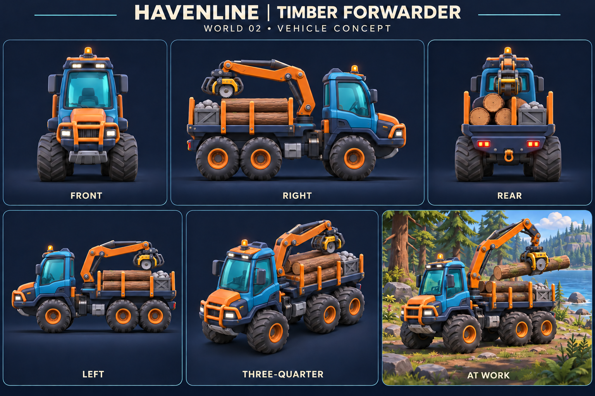
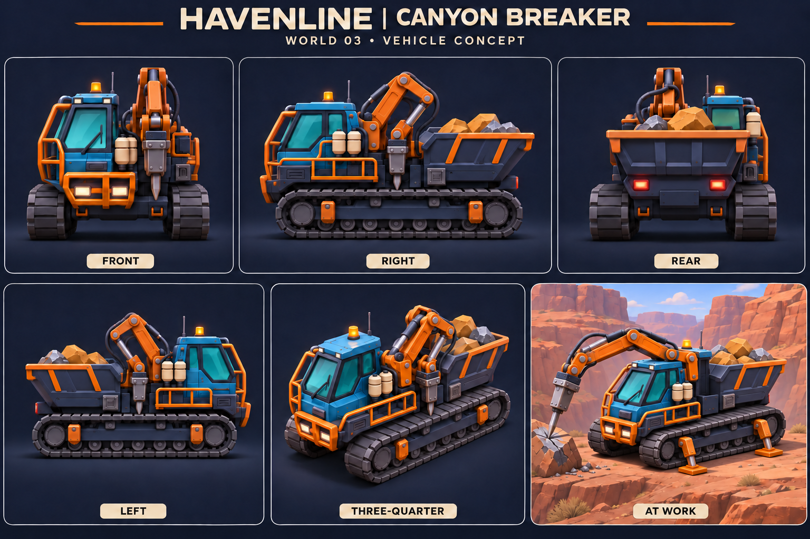
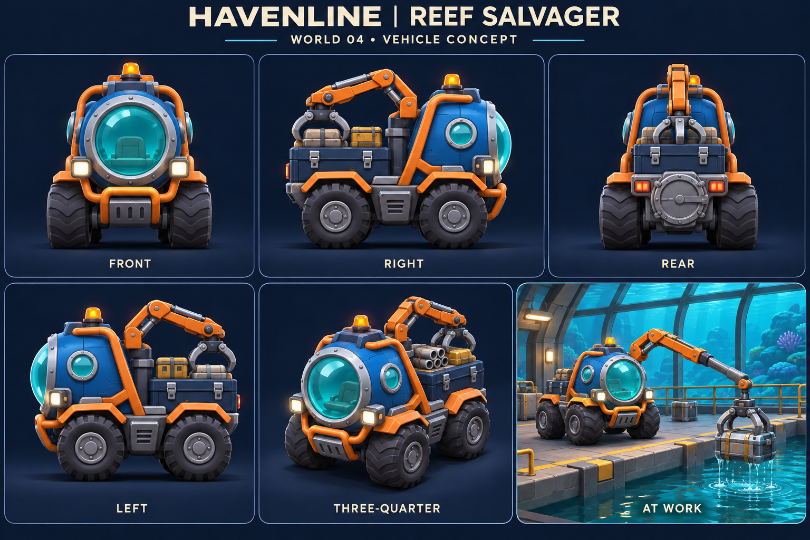
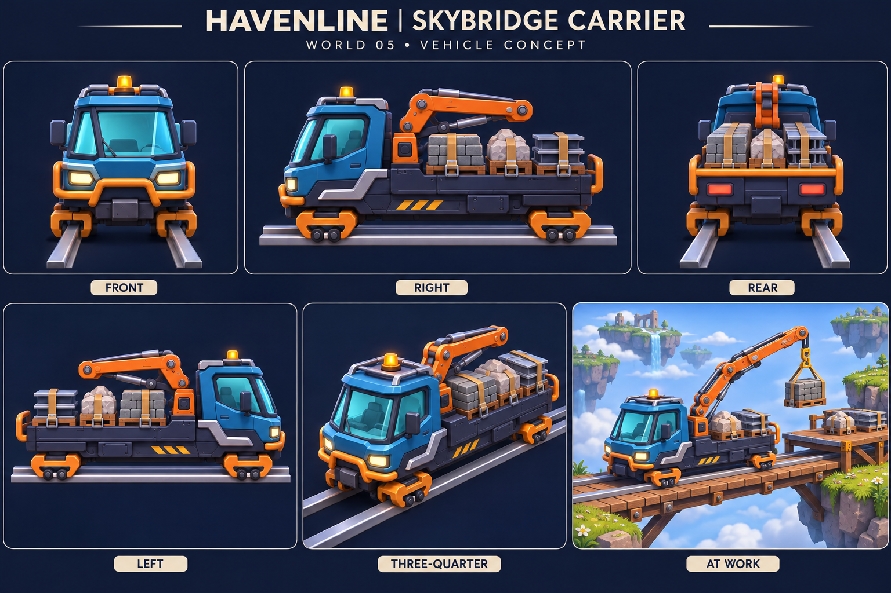
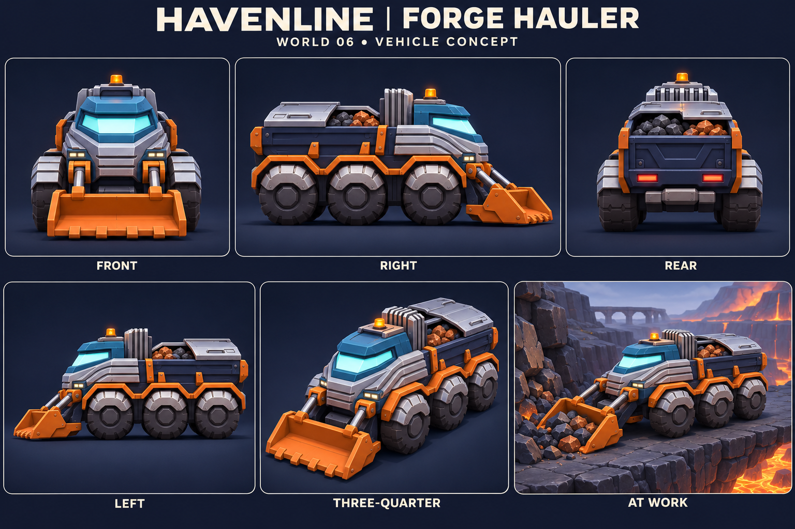
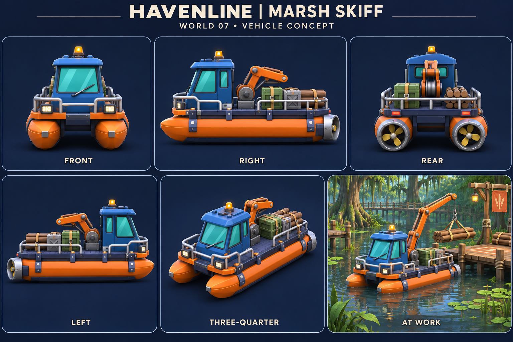
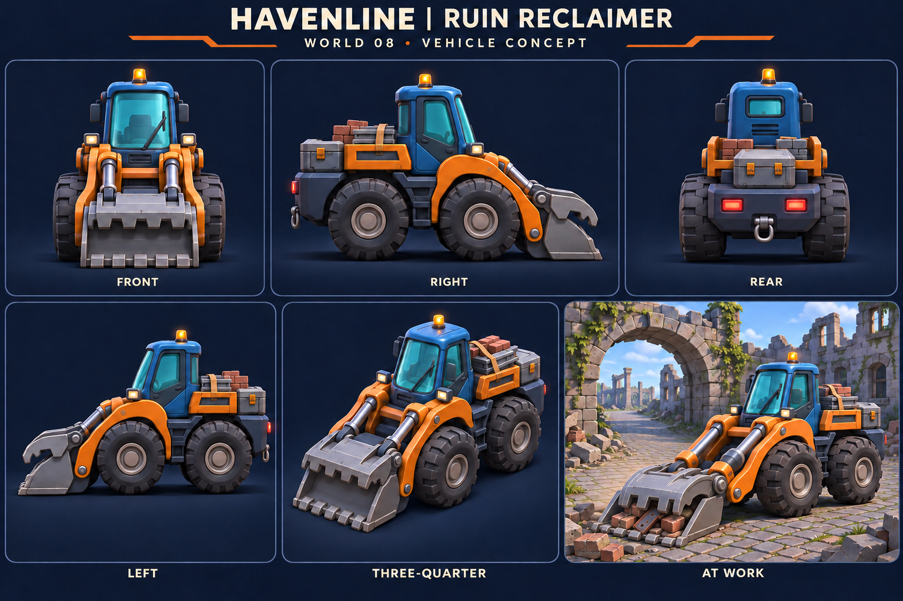
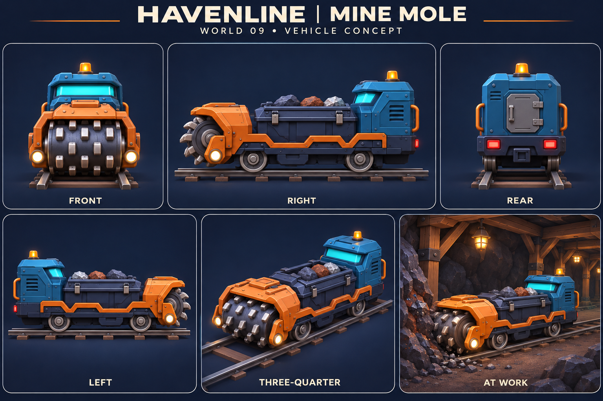
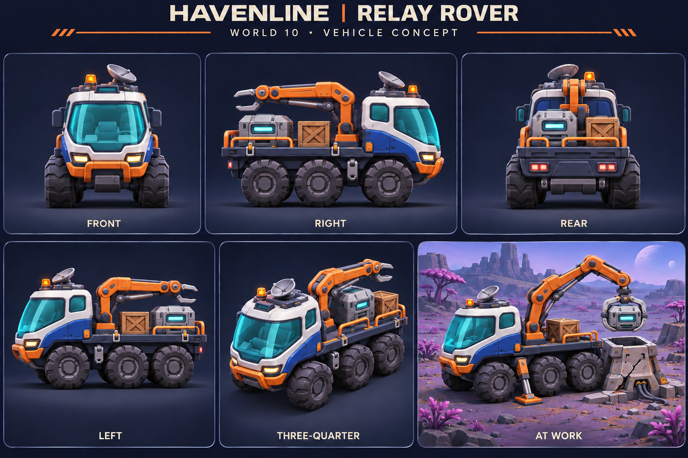

# Havenline — world vehicle concept gallery

Nine authored vehicles for the existing later worlds. Every selected sheet contains **front, rear, left, right, three-quarter and working views**. These are static multi-angle concept renders made with the built-in image-generation tool, not rotating 3D files, game screenshots or native model approvals. The design and material proposals are in [VehicleEconomy](../../../Production/VehicleEconomy/2026-11-27/ECONOMY_DESIGN.md).

The [original snow truck](../../SnowTruckGarage/2026-11-27/selected/snow-truck-360.png) and [fence-line garage](../../SnowTruckGarage/2026-11-27/selected/snow-truck-garage-360.png) remain the World1 concepts. Their earlier fuel scope is superseded by the current low-consumption rule.

## Selected proposal sheets

| World | Vehicle | Useful job | Selected render |
|---|---|---|---|
| 2 — Forest and Lakeshore | **Timber Forwarder** | Cut and load timber; move recurring forest and bridge supplies | [Six-view sheet](renders/w02-timber-forwarder-r2.png) |
| 3 — Desert Canyons | **Canyon Breaker** | Break stone and ore; serve restored canyon freight routes | [Six-view sheet](renders/w03-canyon-breaker-r3.png) |
| 4 — Underwater Refuges | **Reef Salvager** | Lift flooded salvage while the driver stays on protected dry docks | [Six-view sheet](renders/w04-reef-salvager-r1.png) |
| 5 — Sky Islands | **Skybridge Carrier** | Carry and lift freight on completed bridges and captive rails | [Six-view sheet](renders/w05-skybridge-carrier-r1.png) |
| 6 — Volcanic Forge | **Forge Hauler** | Collect cooled ore and supply protected forge causeways | [Six-view sheet](renders/w06-forge-hauler-r1.png) |
| 7 — Swamp Boardwalks | **Marsh Skiff** | Move timber, fish and construction supplies between shallow-water landings | [Six-view sheet](renders/w07-marsh-skiff-r1.png) |
| 8 — Ruined Settlement | **Ruin Reclaimer** | Grip rubble and recover salvage from ruined streets | [Six-view sheet](renders/w08-ruin-reclaimer-r2.png) |
| 9 — Underground Mines | **Mine Mole** | Cut ore at rail workfaces and supply mine supports and lifts | [Six-view sheet](renders/w09-mine-mole-r1.png) |
| 10 — Alien Frontier | **Relay Rover** | Transport and install finite relay modules; continue ordinary repair and supply work | [Six-view sheet](renders/w10-relay-rover-r2.png) |

## Gallery

### World 2 — Timber Forwarder

Cut and load timber; move recurring forest and bridge supplies.

### World 3 — Canyon Breaker

Break stone and ore; serve restored canyon freight routes.

### World 4 — Reef Salvager

Lift flooded salvage while the driver stays on protected dry docks.

### World 5 — Skybridge Carrier

Carry and lift freight on completed bridges and captive rails.

### World 6 — Forge Hauler

Collect cooled ore and supply protected forge causeways.

### World 7 — Marsh Skiff

Move timber, fish and construction supplies between shallow-water landings.

### World 8 — Ruin Reclaimer

Grip rubble and recover salvage from ruined streets.

### World 9 — Mine Mole

Cut ore at rail workfaces and supply mine supports and lifts.

### World 10 — Relay Rover

Transport and install finite relay modules; continue ordinary repair and supply work.

## Review and provenance

[FINAL_CONCEPT_REVIEW.json](reviews/FINAL_CONCEPT_REVIEW.json) binds the selected nine candidates and their actual independent multi-angle inspections. Individual reports preserve defects and retests. R1 attempts and the rejected Canyon R2 remain under `renders/`; they are not interchangeable with the selected revisions. [PROMPTS.json](PROMPTS.json) retains the original prompt bytes. [REPAIR_PROMPTS_R2.json](REPAIR_PROMPTS_R2.json) and [REPAIR_PROMPTS_R3.json](REPAIR_PROMPTS_R3.json) retain the targeted edits. [ARTIFACT_MANIFEST.json](ARTIFACT_MANIFEST.json) binds the published art files.

Authored refinements: Canyon Breaker uses a front-right cab and four stabilizer feet; Mine Mole uses an open ore hopper; Ruin Reclaimer's studio jaw is an illustrative partly open travel pose, while the working pose closes on rubble. Relay Rover keeps six wheels, one clamp and two total stabilizers. Its finite module follows the portable serialized-cargo/replacement proposal in the world contract.

The proposals retain Havenline's chunky blue/orange/navy/silver visual language. Incidental mechanical detail is not a measured engineering drawing. Native mesh construction must resolve dimensions, access, joint travel, full turning, tool cycles, load contact, clearance, garage fit, camera, audio and device performance under the existing stronger production gates. User selection and runtime approval are separate from this concept review.
