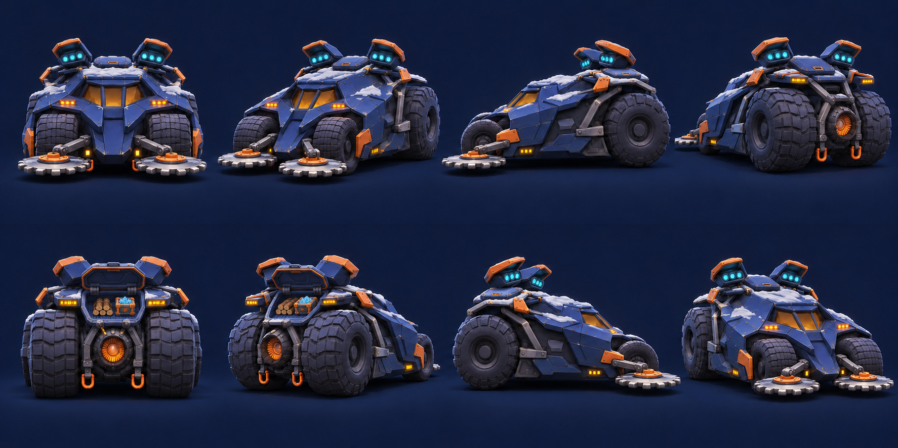

# World 1 vehicle list

| Vehicle | Status | Play role |
| --- | --- | --- |
| Snow Truck | Existing vehicle design; see the gameplay branch for build evidence | General-purpose harvesting and cargo transport. [Snow Truck & Garage](../../../Production/SNOW_TRUCK_GARAGE.md) |
| Tumbler | Planned concept, not a playable vehicle | Armored player-driven resource hauler with twin cutters and a player-fired homing volley. |

## Tumbler

- **Twin horizontal cutters:** Flat, spinning front discs attack in-game enemies, cut trees and break all mineable rock types. Retain the existing paid-camp cutter safety rule.
- **Missile volley:** Automatically acquire up to 10 distinct eligible in-game enemies at once. The player taps Launch to fire; no automatic launch. The missiles track their assigned targets. Shared cooldown: 3 seconds after a successful volley.
- **Resource cargo:** An armored rear hatch above the turbine stores harvested resources. Preserve typed vehicle custody, exactly-once warehouse unloading and the existing inside/outside wreck rules. The render shows logs and a mineral crate as examples, not a capacity limit.
- **Not fixed:** Unlock level, cost, vehicle power source, balance and final runtime assets. This entry does not replace the Snow Truck.

Before claiming gameplay support, test all mineable types (including slate and coal), 0/1/10/>10 eligible targets, no launch without input, and blocked unloading plus save/reload. No gameplay, asset integration or release approval is implied.
